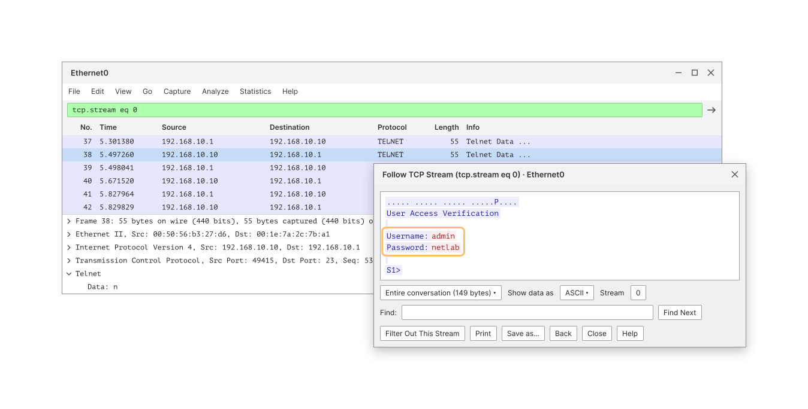
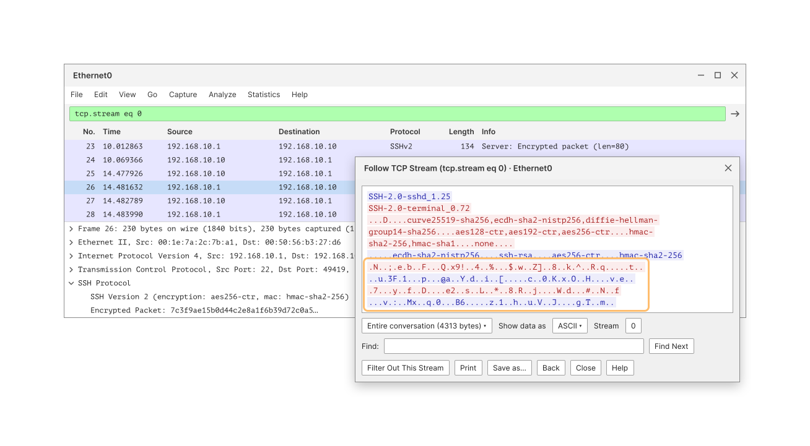

<!-- 1.3.1 -->
## Принцип работы Telnet

Вы не всегда можете иметь прямой доступ к коммутатору при необходимости его настройки. Вы должны иметь возможность удаленного доступа к нему, и очень важно, чтобы это было безопасно. В этом разделе описывается настройка Secure Shell (SSH) для удаленного доступа. Задание в симуляторе дает вам возможность попробовать это самостоятельно.

Telnet использует TCP-порт 23. Он является более ранним протоколом, использующим небезопасную незашифрованную передачу как данных, так и идентификационной информации (имя пользователя и пароль) между взаимодействующими устройствами. Злоумышленник может отслеживать пакеты с помощью анализатора протоколов. Например, на рисунке показано, как злоумышленник записал имя пользователя **admin** и пароль **netlab** из сеанса Telnet.




<!--
Захват кадров сеанса Telnet анализатором протоколов: имя пользователя и пароль отправлены открытым текстом
-->

<!-- 1.3.2 -->
## Принцип работы SSH

**Secure Shell** (SSH) — это безопасный протокол, который использует TCP-порт 22. Он обеспечивает безопасное (зашифрованное) подключение для управления удаленным устройством. Для безопасного управления удаленными подключениями рекомендуется заменить Telnet на SSH. SSH обеспечивает защиту удаленных подключений, предоставляя надежное шифрование данных аутентификации устройства, а также данных, передаваемых между устройствами.

Например, на рисунке показан захват сеанса SSH анализатором протоколов. Злоумышленник может отслеживать сеанс, используя IP-адрес устройства администратора. Однако в отличие от Telnet, с SSH имя пользователя и пароль шифруются.




<!--
Захват сеанса SSH анализатором протоколов: имя пользователя и пароль зашифрованы
-->

<!-- 1.3.3 -->
## Убедитесь, что коммутатор поддерживает SSH

Протокол SSH работает только в той ОС, которая поддерживает криптографические функции (шифрование): для одной модели коммутатора производитель обычно выпускает образы ОС с такими функциями и без них. Какой образ ОС и какая версия работают на коммутаторе, показывает команда **show version** — строки с названием и версией ОС и строка `System image file`.

```
S1#show version
NSALAB NetOS Software, NS01 Software (NS01-NETOS-M), Version 0.1.0, RELEASE SOFTWARE
Copyright (c) 2026 NSALAB

S1 uptime is 0 minutes
System returned to ROM by power-on
System image file is "flash0:ns01-netos-0.1.0.bin"

NSALAB NS01 (revision 1.0) with 65536K bytes of memory.
Processor board ID NSA00000001
24 FastEthernet interfaces
2 Gigabit Ethernet interfaces
256K bytes of non-volatile configuration memory.

Configuration register is 0x2102
```

Проверить поддержку SSH напрямую позволяет команда **show ip ssh**: если ОС поддерживает SSH, команда распознается и выводит состояние сервера SSH. Пока на коммутаторе нет ключей RSA, SSH выключен, как в примере.

```
S1#show ip ssh
SSH Disabled - version 1.99
%Please create RSA keys to enable SSH (and of atleast 768 bits for SSH v2).
```

<!-- 1.3.4 -->
## Конфигурация SSH

Перед настройкой протокола SSH на коммутаторе нужно присвоить коммутатору уникальное имя и задать параметры сетевого подключения.

**Шаг 1. Проверка поддержки SSH**

Используйте команду **show ip ssh**, чтобы убедиться, что коммутатор поддерживает SSH. Если на коммутаторе не работает ОС, поддерживающая криптографические функции, эта команда не распознается.

```
S1# show ip ssh 
```

**Шаг 2. Настройка IP-домена**

Настройте имя IP-домена сети с помощью команды режима глобальной конфигурации **ip domain-name**. На рисунке значение _domain-name_ равно **nsalab.local**.

```
S1(config)# ip domain-name nsalab.local
```

**Шаг 3. Создание пары ключей RSA**

Не все версии ОС по умолчанию используют вторую версию SSH, а SSH первой версии имеют известные недостатки безопасности. Чтобы настроить SSH версии 2, выполните команду **ip ssh version 2** режима глобальной конфигурации. При создании пары ключей RSA автоматически включается SSH. Используйте команду **crypto key generate rsa**, чтобы включить SSH-сервер на коммутаторе и создать пару ключей RSA. При создании ключей RSA администратору предлагается ввести длину модуля. В примере конфигурации используется размер модуля 1024 бита. Более длинная длина модуля более безопасна, но для генерации и использования требуется больше времени.

**Примечание.** Чтобы удалить пару ключей RSA, используйте команду **crypto key zeroize rsa** режима глобальной конфигурации. После удаления пары ключей RSA сервер SSH автоматически отключается.

```
S1(config)# crypto key generate rsa
How many bits in the modulus [512]: 1024 
```

**Шаг 4. Настройка аутентификации пользователей**

Сервер SSH может аутентифицировать пользователей локально или с помощью сервера аутентификации. Для использования метода локальной аутентификации создайте имя пользователя и пароль с помощью команды режима глобальной настройки **username** _username_ **secret** _password_. В этом примере администратору пользователя присваивается пароль **netlab**.

```
S1(config)# username admin secret netlab
```

**Шаг 5. Настройка vty-линий** 

Включите протокол SSH на линиях vty с помощью команды режима конфигурации линии **transport input ssh**. Коммутатор в этом примере имеет линии vty в диапазоне от 0 до 15. Эта конфигурация предотвращает подключения, отличные от SSH (например, Telnet), и ограничивает коммутатор принимать только SSH соединения. Используйте команду **line vty**, а затем команду **login local**, чтобы активировать локальную аутентификацию для SSH-соединений из локальной базы данных имени пользователя.

```
S1(config)# line vty 0 15
S1(config-line)# transport input ssh
S1(config-line)# login local
S1(config-line)# exit
```

**Шаг 6. Включение SSHv2**

По умолчанию SSH поддерживает обе версии (1 и 2). При поддержке обеих версий это отображается в выходных данных **show ip ssh** как поддерживающая версия 2. Включите версию SSH с помощью команды глобальной конфигурации **ip ssh version 2**. 

```
S1(config)# ip ssh version 2
```

<!-- 1.3.5 -->
## Убедитесь, что SSH работает

Для подключения к серверу SSH на ПК используется встроенный SSH-клиент. Например, предположим следующее:

* SSH включен на коммутаторе S1;
* на коммутаторе S1 интерфейсу VLAN 99 (SVI) присвоен IPv4-адрес 172.17.99.11;
* компьютеру PC1 присвоен IPv4-адрес 172.17.99.21.

На рисунке PC инициирует SSH-подключение по IPv4-адресу VLAN SVI коммутатора S1.


<!--
На рисунке показан хост, подключенный к коммутатору, и настройки PuTTY для инициирования SSH-подключения к SVI коммутатора. Узел PC1 с адресом 172.17.99.21 имеет сетевое подключение к коммутатору S1 с адресом 172.17.99.11. Скриншот конфигурации PuTTY на PC1 показывает адрес 172.17.99.11, введенный в поле «Имя узла» (или IP-адрес), и 22, введенный в поле «Порт». В качестве типа подключения выбран SSH.
-->

При подключении пользователю будет предложено ввести имя пользователя и пароль, как показано в примере. Используя конфигурацию, приведенную в предыдущем примере, вводятся имя пользователя **admin** и пароль **netlab**. После ввода правильной комбинации пользователь подключается через SSH к интерфейсу командной строки (CLI) коммутатора.

```
The authenticity of host '172.17.99.11' can't be established.
ECDSA key fingerprint is SHA256:UBbv42HNcpT5eTwtqk2rctA1RxSUiRcLj7z6uxuCqtY.
Are you sure you want to continue connecting (yes/no/[fingerprint])? [!mark!]yes[!/mark!] <--- необходимо подтверждение
Warning: Permanently added '172.17.99.11' (ECDSA) to the list of known hosts.
admin@172.17.99.11's password: [!mark!]netlab[!/mark!] <--- пароль не будет отображаться при вводе в целях безопасности
S1> enable
Password: 
S1#
```

Для отображения используемой версии и конфигурации для протокола SSH на устройстве, который вы настроили в качестве сервера SSH, используйте команду **show ip ssh**. В примере включена вторая версия SSH. 

```
S1# show ip ssh
SSH Enabled - version 2.0
Authentication timeout: 120 secs; Authentication retries: 3
To check the SSH connections to the device, use the show ssh command as shown.
S1# show ssh
%No SSHv1 server connections running.
Connection Version Mode Encryption  Hmac                State          Username
0          2.0     IN   aes256-cbc  hmac-sha1    Session started       admin
0          2.0     OUT  aes256-cbc  hmac-sha1    Session started       admin
S1#
```


