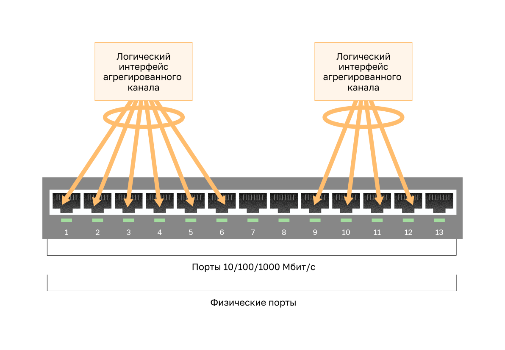

<!-- 6.1.1 -->
## Агрегирование каналов

Существуют сценарии, в которых требуется большая пропускная способность или резерв между устройствами, что может быть обеспечено одним каналом. Множественные каналы могут быть соединены между устройствами для увеличения пропускной способности. Однако STP, который по умолчанию включен на многих устройствах уровня 2, например на коммутаторах, блокирует резервные каналы, чтобы предотвратить возникновение петли коммутации. Например, если коммутатор доступа соединен двумя каналами с каждым из двух многоуровневых коммутаторов, STP блокирует по одному каналу в каждой паре.

Необходима технология агрегации каналов, позволяющая создавать резервные связи между устройствами, которые не будут блокироваться STP. Эта технология известна как EtherChannel.

**EtherChannel** — это технология агрегации каналов, которая группирует несколько физических каналов Ethernet в один логический. Он используется для обеспечения устойчивости к сбоям, распределения нагрузки, увеличения пропускной способности и резерва между коммутаторами, маршрутизаторами и серверами.

Технология EtherChannel может объединить несколько физических каналов между коммутаторами, что позволит увеличить общую скорость обмена данными между этими устройствами.

<!-- 6.1.2 -->
## EtherChannel

Технология EtherChannel изначально была разработана как технология LAN типа «коммутатор-коммутатор» для объединения нескольких портов Fast Ethernet или Gigabit Ethernet в один логический канал. При настройке EtherChannel создается виртуальный интерфейс, который называется агрегированный канал (port channel). Физические интерфейсы объединяются в его интерфейс. Например, если коммутатор доступа соединен двумя физическими каналами с каждым из двух многоуровневых коммутаторов, каждая пара каналов объединяется в свой EtherChannel.

<!-- 6.1.3 -->
## Преимущества EtherChannel

Технология EtherChannel имеет много достоинств.

* Большинство задач конфигурации выполняется на интерфейсе EtherChannel, а не на отдельных портах. Это обеспечивает согласованную конфигурацию на всех каналах.
* EtherChannel использует существующие порты коммутатора. Для обеспечения более высокой пропускной способности не требуется дорогостоящая замена канала на более быстрый.
* Между каналами, которые являются частью одного и того же EtherChannel, происходит распределение нагрузки. В зависимости от используемого оборудования может быть реализован один или несколько методов балансировки нагрузки. К этим методам относятся, например, распределение нагрузки по физическим каналам на основе MAC-адресов источника и назначения или на основе IP-адресов источника и назначения.
* EtherChannel создает объединение, которое рассматривается, как один логический канал. Если между двумя коммутаторами существует несколько объединений EtherChannel, STP может блокировать одно из них во избежание петель коммутации. Если происходит блокировка одного из резервных каналов, блокируется весь EtherChannel, в том числе все относящиеся к нему порты. Если существует только один канал EtherChannel, все физические каналы в EtherChannel активны, поскольку STP видит только один (логический) канал.
* EtherChannel предоставляет функции резервности, поскольку общий канал считается одним логическим соединением. Кроме того, потеря одного физического соединения в пределах канала не приводит к изменению в топологии. Поэтому перерасчет STP не требуется. При условии, что имеется хотя бы одно физическое соединение, EtherChannel продолжает работать даже в том случае, если общая пропускная способность снижается из-за потери соединения в его пределах.

<!-- 6.1.4 -->
## Ограничения использования

EtherChannel имеет определенные ограничения реализации.

* Нельзя одновременно использовать разные типы интерфейсов. Например, нельзя смешивать Fast Ethernet и Gigabit Ethernet в пределах одного канала EtherChannel.
* В настоящее время все каналы EtherChannel могут содержать до восьми совместимо настроенных Ethernet-портов. EtherChannel предоставляет полнодуплексную полосу пропускания до 800 Мбит/с (Fast EtherChannel) или 8 Гбит/с (Gigabit EtherChannel) между двумя коммутаторами или между коммутатором и узлом.
* Коммутатор уровня 2 может поддерживать, например, до шести каналов EtherChannel. Тем не менее с появлением новых версий ОС и изменением платформ некоторые карты и платформы могут получить возможность поддерживать большее количество портов в пределах одного канала EtherChannel, а также большее количество каналов Gigabit EtherChannel.
* Все порты одного канала EtherChannel должны быть настроены одинаково: либо все как порты второго уровня, либо все как маршрутизируемые порты третьего уровня. Если физические порты на одной стороне канала настроены в качестве магистральных (trunk), порты на другой стороне также должны быть магистральными с той же собственной VLAN (native VLAN).
* Каждый EtherChannel имеет логический интерфейс агрегированного канала. Его настройка применяется на все физические интерфейсы, связанные с этим логическим интерфейсом.

<!-- 6.1.5 -->
## Протоколы автосогласования

EtherChannel можно образовать путем согласования с использованием одного из двух протоколов — Port Aggregation Protocol (PAgP) или Link Aggregation Control Protocol (LACP). Данные протоколы позволяют портам со сходными характеристиками образовывать каналы путем динамического согласования со смежными коммутаторами.

**Примечание.** Также возможна настройка статического или безусловного канала EtherChannel без использования PAgP или LACP.

<!-- 6.1.6 -->
## Функции PAgP

**PAgP** — это проприетарный протокол, который предназначен для автоматизации создания каналов EtherChannel. Когда канал EtherChannel настраивается с помощью PAgP, пакеты этого протокола пересылаются между портами с поддержкой EtherChannel в целях согласования создания канала. Когда PAgP определяет совпадающие соединения Ethernet, он группирует их в канал EtherChannel. Далее EtherChannel добавляется в связующее дерево как один порт.

Если включен PAgP, он также участвует в управлении EtherChannel. Отправка пакетов PAgP выполняется с интервалом в 30 секунд. PAgP проверяет согласованность конфигурации и обрабатывает добавление и выход из строя каналов между двумя коммутаторами. Таким образом обеспечивается использование согласованной конфигурации для всех портов при создании EtherChannel.

**Примечание.** В EtherChannel все порты одного коммутатора обязательно должны иметь одинаковые скорость, настройки дуплекса и настройки VLAN. Настройка, измененная после создания канала на интерфейсе агрегированного канала (port-channel), применяется ко всем его портам. Если же изменить настройку только на одном порте, остальные порты не меняются, и этот порт может выйти из канала из-за несовместимости.

PAgP позволяет создать EtherChannel путем обнаружения конфигурации на каждой из сторон и обеспечения совместимости каналов, чтобы EtherChannel мог быть включен в случае необходимости.

**Режимы PAgP**

* **PAgP desirable** (рекомендуемый) — режим PAgP помещает интерфейс в активное состояние согласования, в котором инициируется согласование с другими интерфейсами путем отправки пакетов PAgP.
* **PAgP auto** (автоматический) — режим PAgP помещает интерфейс в пассивное состояние согласования, в котором интерфейс отвечает на полученные пакеты PAgP, но не инициирует их согласование.

Режимы должны быть совместимыми на каждой из сторон. Если одна из них настроена в автоматическом режиме, она помещается в пассивное состояние, ожидая инициации согласования EtherChannel другой стороной. Если для другой стороны также задан автоматический режим, согласование не начнется и EtherChannel не образуется. Если все режимы отключены с помощью команды **no** или ни один из них не настроен, EtherChannel отключается.

Кроме режимов PAgP, есть статический режим **On** (включено). Он помещает интерфейс в канал EtherChannel без выполнения согласования и не использует ни PAgP, ни LACP: интерфейсы в этом режиме не обмениваются пакетами PAgP. Он работает только в том случае, если для другой стороны также задан режим **On**. Если для другой стороны параметры согласования заданы с помощью PAgP, образование EtherChannel не выполнится, поскольку та сторона, для которой задан режим **On**, не выполняет согласование.

Если между двумя коммутаторами нет согласования, что отсутствует проверка, все каналы в EtherChannel завершаются на другой стороне или на другом коммутаторе используются совместимые параметры PAgP.

<!-- 6.1.7 -->
## Пример настроек режима PAgP

Например, коммутаторы S1 и S2 соединены двумя каналами. Установят ли S1 и S2 EtherChannel с помощью PAgP, зависит от настроек режима на каждой стороне канала.

В таблице показаны различные сочетания режимов PAgP на S1 и S2 и результат создания канала.

| **S1** | **S2** | **Формирование канала** |
| --- | --- | --- |
| Включено | Включено | Да |
| Вкл | Рекомендуемый/Автоматический | Нет |
| Рекомендуемый | Рекомендуемый | Да |
| Рекомендуемый | Авто | Да |
| Автоматически | Рекомендуемый | Да |
| Автоматически | Автоматически | Нет |

<!-- 6.1.8 -->
## Функции LACP

LACP определяется стандартом IEEE (802.3ad), который обеспечивает возможность объединения нескольких физических портов для создания единого логического канала. Он помогает согласовывать коммутатором автоматическое объединение путем отправки пакетов LACP на другой коммутатор. Он выполняет функцию, сходную с функциями PAgP для EtherChannel. Поскольку протокол LACP относится к стандарту IEEE, его можно использовать для упрощения работы с EtherChannel в неоднородных средах. Многие устройства поддерживают оба протокола.

**Примечание.** LACP изначально определен как стандарт IEEE 802.3ad. Тем не менее теперь протокол LACP определяется более новой версией, стандартом IEEE 802.1AX для локальных и городских сетей.

Протокол LACP предоставляет те же преимущества при согласовании, что и протокол PAgP. Протокол LACP позволяет создать канал EtherChannel путем обнаружения конфигурации на каждой из сторон и обеспечения совместимости каналов, чтобы канал EtherChannel мог быть включён в случае необходимости.

**Режимы LACP**

* **LACP active** (активный) — порт помещается в активное состояние согласования. Он инициирует согласование с другими портами путем отправки пакетов LACP.
* **LACP passive** (пассивный) —  порт помещается в пассивное состояние согласования. Он отвечает на полученные пакеты LACP, но не инициирует их согласование.

Как и в случае с PAgP, для формирования EtherChannel режимы должны быть совместимы на обеих сторонах. Статический режим **On** не относится ни к LACP, ни к PAgP: он создает канал EtherChannel безусловно, без динамического согласования, и интерфейсы в этом режиме не обмениваются пакетами LACP. Канал образуется, только если на другой стороне тоже задан режим **On**.

LACP позволяет создать восемь активных, а также восемь резервных каналов. Резервный канал становится активным при сбое одного из текущих активных.

<!-- 6.1.9 -->
## Пример настроек режима LACP

Например, коммутаторы S1 и S2 соединены двумя каналами. Установят ли S1 и S2 EtherChannel с помощью LACP, зависит от настроек режима на каждой стороне канала.

В таблице показаны различные комбинации режимов LACP на S1 и S2 и полученные результаты создания канала.

| **S1** | **S2** | **Формирование канала** |
| --- | --- | --- |
| Включено | Включено | Да |
| Вкл | Активный/Пассивный | Нет |
| Активный | Активный | Да |
| Активный | Пассивный | Да |
| Пассивный | Active | Да |
| Пассивный | Пассивный | Нет |

<!-- 6.1.10 -->
<!-- quiz -->

