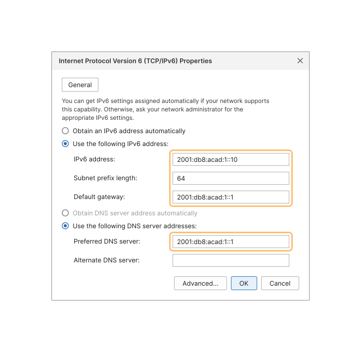
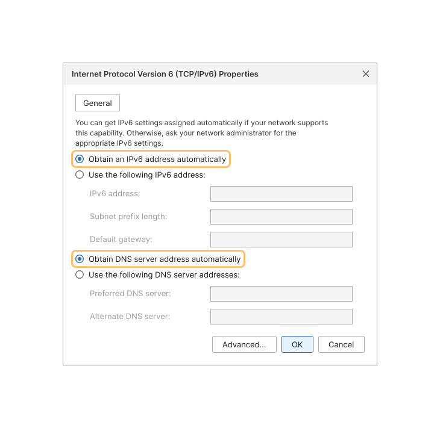
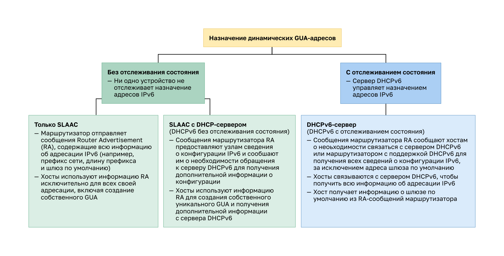

<!-- 8.1.1 -->
## Конфигурация IPv6-адресации

Начнем с главного. Чтобы использовать автоконфигурацию адресов без сохранения состояния (SLAAC) или DHCPv6, необходимо просмотреть глобальные одноадресные адреса (GUA) и локальные адреса канала (LLA). Этот раздел охватывает и то, и другое.

На маршрутизаторе глобальный одноадресный IPv6-адрес настраивается вручную с помощью команды конфигурации интерфейса **ipv6 address _ipv6-address/prefix-length_**.

Узел Windows также может быть настроен вручную. Например, в окне **Internet Protocol Version 6 (TCP/IPv6) Properties** выбирают **Use the following IPv6 address** и вводят IPv6-адрес 2001:db8:acad:1::10, длину префикса 64 и шлюз по умолчанию 2001:db8:acad:1::1, а в поле **Preferred DNS server** — адрес DNS-сервера, здесь тоже 2001:db8:acad:1::1.




Ввод GUA IPv6 вручную может занять много времени и несколько подвержен ошибкам. Таким образом, большинство узлов Windows имеют возможность динамически приобретать конфигурацию GUA IPv6: для этого в том же окне выбирают **Obtain an IPv6 address automatically** и **Obtain DNS server address automatically**.




<!-- 8.1.2 -->
## Локальный адрес канала

Если выбрана автоматическая IPv6-адресация, узел попытается автоматически получить и настроить информацию об адресах IPv6 на интерфейсе. Узел будет использовать один из трех методов, определенных в сообщении **Router Advertisement** (RA), полученном на интерфейсе протокола управления сообщениями (Internet Control Message Protocol версии 6 (ICMPv6). Маршрутизатор IPv6, находящийся по той же ссылке, что и узел, отправляет сообщения RA. Они предлагают узлам, как получить информацию об адресации IPv6. Локальный адрес канала IPv6 автоматически создается узлом при загрузке и активном интерфейсе Ethernet. Пример **ipconfig** выходных данных показывает автоматически сгенерированный адрес связи (LLA) на интерфейсе.

Обратите внимание, что интерфейс не создал GUA IPv6: строка **IPv6 Address** в выводе пуста. Причина заключается в том, что в данном примере сегмент сети не имеет маршрутизатора для предоставления инструкций по настройке сети для узла.

**Примечание.** Операционные системы иногда показывают локальный адрес связи, добавляемый символом **«%»** и числом. Это называется идентификатором зоны или области. Он используется ОС для связывания LLA с определенным интерфейсом.

**Примечание.** Протокол DHCPv6 определяется в RFC 3315.

```
C:\PC1> ipconfig
Windows IP Configuration
Ethernet adapter Ethernet0:
   Connection-specific DNS Suffix  . : 
   IPv6 Address. . . . . . . . . . . : 
   Link-local IPv6 Address . . . . . : fe80::fb:1d54:839f:f595%21
   IPv4 Address. . . . . . . . . . . : 169.254.202.140
   Subnet Mask . . . . . . . . . . . : 255.255.0.0
   Default Gateway . . . . . . . . . : 
C:\PC1>
```

<!-- 8.1.3 -->
## Глобальный адрес IPv6

IPv6 был разработан, чтобы упростить способ получения узлом конфигурации IPv6. По умолчанию маршрутизатор с поддержкой IPv6 объявляет информацию IPv6. Это позволяет узлу динамически создавать или получать конфигурацию IPv6.

GUA IPv6 может быть назначен динамически с помощью служб без сохранения состояния и с сохранением состояния. Без сохранения состояния ни одно устройство не отслеживает назначенные адреса: узел сам создает GUA по информации из RA — либо только по SLAAC, либо по SLAAC вместе с сервером DHCPv6 без сохранения состояния, от которого узел получает дополнительные параметры. С сохранением состояния назначением адресов управляет сервер DHCPv6, а адрес шлюза по умолчанию узел по-прежнему получает из RA.

Все методы без сохранения состояния и с сохранением состояния в этом модуле используют ICMPv6 RA-сообщения, чтобы предложить узлу, как создать или получить его конфигурацию IPv6. Хотя операционные системы следуют предложению RA, фактическое решение в конечном итоге зависит от узла.




<!-- 8.1.4 -->
## Три флага сообщений RA

Решение о том, как клиент получит GUA IPv6, зависит от настроек в сообщении RA.

Сообщение ICMPv6 RA содержит три флага для определения динамических параметров, доступных узлу.

* **Флаг А** – это флаг автонастройки адреса. Автоматическая конфигурация адреса без сохранения состояния (Stateless Address Autoconfiguration, SLAAC) для создания IPv6 GUA.
* **Флаг Other Configuration (флаг O)** – это флаг конфигурации Other. Другая информация доступна с сервера DHCPv6 без сохранения состояния.
* **Флаг Managed Address Configuration (флаг M)** – это флаг настройки управляемого (managed) адреса. Используйте сервер DHCPv6 с сохранением состояния для получения GUA IPv6.

Используя различные комбинации флагов A, O и M, сообщения RA информируют узел о доступных динамических параметрах.

Например, в ответ на сообщение RS от компьютера PC1 маршрутизатор R1 может отправить RA с одной из трех комбинаций флагов: только SLAAC (по умолчанию) — A = 1, O = 0, M = 0; SLAAC и DHCPv6 без сохранения состояния — A = 1, O = 1, M = 0; только DHCPv6 с сохранением состояния — A = 0, M = 1.


<!-- 8.1.5 -->
<!-- quiz -->
