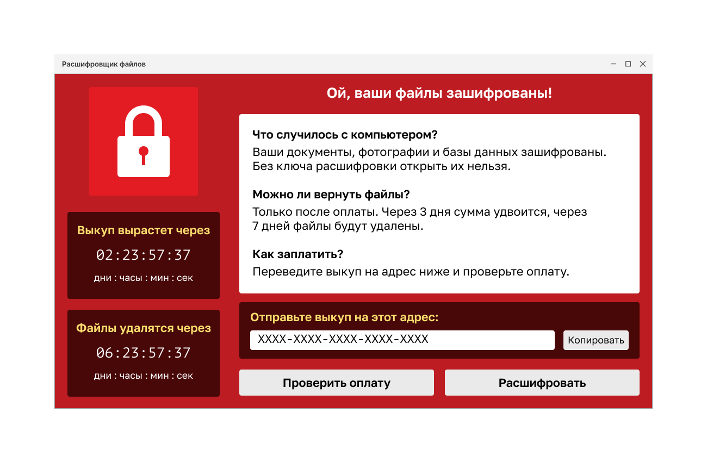

<!-- 10.1.1 -->
## Сетевые атаки сегодня 

В новостях часто рассказывают о внешних атаках на корпоративные сети. Просто найдите в Интернете «последние сетевые атаки», чтобы найти актуальную информацию о них. Скорее всего, эти атаки будут включать одно или несколько из следующих действий:

* **распределенный отказ в обслуживании (DDoS)** – это скоординированная атака со многих устройств, называемых зомби, с целью ослабления или прекращения публичного доступа к сайту и ресурсам организации;
* **кража данных** – это атака, при которой серверы или узлы организации подвергаются риску кражи конфиденциальной информации;
* **вредоносное ПО** – это атака, при которой узлы организации заражаются вредоносным программным обеспечением, вызывающим множество проблем (например, вымогатель, показанный на рисунке, шифрует данные на узле и блокирует доступ к нему, пока выкуп не будет выплачен).

<!-- 10.1.2 -->
## Устройства сетевой безопасности 

Для защиты периметра сети от внешнего доступа необходимы различные устройства обеспечения сетевой безопасности. Они могут включать в себя маршрутизатор с поддержкой виртуальной частной сети (VPN), межсетевой экран следующего поколения (NGFW) и устройство контроля доступа к сети (NAC).

**Маршрутизатор с поддержкой VPN**

Маршрутизатор с поддержкой VPN обеспечивает безопасное соединение с удаленными пользователями в общедоступной и в корпоративной сети. VPN-сервисы могут быть интегрированы в брандмауэр.

**NGFW**

NGFW предоставляет такие возможности, как отслеживание работы приложений и управление ими, система предотвращения вторжений нового поколения, расширенная защита от вредоносного ПО и фильтрация URL-адресов.

**NAC**

Устройство NAC включает в себя сервисы (ААА), такие как аутентификация, авторизация и учет. На крупных предприятиях эти службы выносят на отдельный сервер NAC, который управляет политиками доступа для широкого круга пользователей и типов устройств.

<!-- 10.1.3 -->
## Защита оконечных устройств 

Устройства локальной сети, такие как коммутаторы, контроллеры беспроводной локальной сети (WLC) и другие устройства точки доступа (AP), соединяют конечные точки. Большинство из них подвержены атакам, связанным с локальной сетью, которые рассматриваются в этом модуле.

Однако источники многих атак находятся внутри сети. Если было проникновение на внутренний узел, хакер может использовать его как отправную точку для получения доступа к критически важным системным устройствам, таким как серверы и хранилища конфиденциальной информации.

**Конечные точки** – это узлы, которые обычно состоят из ноутбуков, компьютеров, серверов и IP-телефонов, а также принадлежащих сотрудникам устройств, которые обычно называются вашими собственными устройствами (BYOD). Конечные точки особенно восприимчивы к атакам, связанным с вредоносными программами, которые исходят из электронной почты или просмотра веб-страниц. На этих конечных точках обычно используются традиционные функции безопасности на уровне узла, такие как антивирусное ПО, брандмауэры на базе узла и системы предотвращения вторжений на базе узла (HIPS). Однако сегодня конечные точки лучше всего защищены комбинацией NAC, программного обеспечения для защиты от вредоносного ПО на основе узла, шлюза безопасности почты и шлюза веб-безопасности.

На рисунке показана простая топология, представляющая все устройства сетевой безопасности и решения для оконечных устройств, обсуждаемые в этом модуле.

<!-- 10.1.4 -->
## Защита электронной почты 

Устройства защиты контента включают детальный контроль над электронной почтой и просмотром веб-страниц для пользователей организации.

По данным отраслевых отчётов, в июне 2019 года 85% всей отправленной электронной почты было спамом. Фишинговые атаки являются особо опасной формой спама. Напомним, что **фишинговая атака** побуждает пользователя щелкнуть ссылку или открыть вложение. Она нацелена на высокопоставленных сотрудников или руководителей, которые могут иметь доступ к важным данным Это особенно важно в сегодняшних условиях, когда, по данным Института SANS, 95% всех атак на корпоративные сети являются результатом успешного фишинга.

**Шлюз безопасности почты** – пример устройства, предназначенного для мониторинга SMTP-протокола. Он постоянно обновляется, используя информационные каналы об угрозах в режиме реального времени от исследовательской группы производителя, которая обнаруживает и сопоставляет угрозы, используя всемирную систему мониторинга баз данных. Шлюз получает эти данные об угрозах каждые три-пять минут. Вот некоторые из функций шлюза безопасности почты:

* блокировка угроз;
* защита от вредоносного ПО, которое уклоняется от первоначального обнаружения;
* отброс писем с плохими ссылками (как показано на рисунке);
* блокировка доступа к новым зараженным сайтам;
* шифровка содержимого в исходящей электронной почте, чтобы предотвратить потерю данных.

На рисунке шлюз безопасности почты отбрасывает электронную почту с плохими ссылками.

1. Злоумышленник отправляет фишинговую атаку на важный узел в сети.
2. Брандмауэр пересылает всю электронную почту на шлюз безопасности почты.
3. Шлюз безопасности почты анализирует почту, регистрирует ее, и, если это вредоносное ПО, отбрасывает.

<!-- 10.1.5 -->
## Защита веб-трафика

**Шлюз веб-безопасности** (веб-прокси) – пример технологии нейтрализации веб-угроз. Вместе они позволяют решить задачи, связанные с защитой и контролем трафика. Шлюз предоставляет защиту от вредоносного ПО, мониторинг и контроль функционирования приложений, а также средства управления политиками допустимого использования, создания отчетов.

Шлюз веб-безопасности обеспечивает полный контроль над доступом пользователей к Интернету. Некоторые функции и приложения, такие как чат, обмен сообщениями, видео и аудио, могут быть разрешены, ограничены по времени и полосе пропускания или заблокированы в соответствии с требованиями организации. Шлюз может выполнять внесение в черный список URL-адресов, их фильтрацию, сканирование на наличие вредоносных программ, категоризацию URL-адресов, фильтрацию веб-приложений, а также шифрование и дешифрование трафика.

На рисунке корпоративный сотрудник использует смартфон, чтобы попытаться подключиться к известному помещенному в черный список сайту.

1. Пользователь пытается подключиться к сайту.
2. Брандмауэр направляет запрос сайта на шлюз веб-безопасности.
3. Шлюз веб-безопасности оценивает URL-адрес и определяет, что он внесен в черный список. Шлюз отбрасывает пакет и отправляет пользователю сообщение об отказе в доступе.

<!-- 10.1.6 -->
<!-- quiz -->
