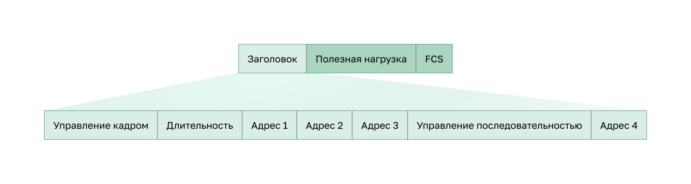

<!-- 12.3.1 -->
## Видео: принципы работы беспроводной локальной сети

Предыдущая тема охватывала компоненты WLAN. Эта тема будет охватывать принципы работы такой сети.

Посмотрите видео о принципах работы WLAN.

<!-- 12.3.2 -->
## Режимы топологии беспроводной сети 802.11

Беспроводные сети LAN могут использовать различные топологии сети. Стандарт 802.11 определяет два основных режима: **режим Ad hoc** и **режим инфраструктуры**. Ещё один режим — режим модема (tethering) — иногда используют, чтобы быстро получить беспроводной доступ.

**Режим Ad hoc** используется, когда два устройства подключаются по беспроводной сети по одноранговой схеме (P2P) без использования точек доступа или беспроводных маршрутизаторов. Примерами могут служить беспроводные клиенты, подключающиеся напрямую друг к другу через Bluetooth или Wi-Fi Direct. В стандарте IEEE 802.11 сеть ad hoc называется независимым базовым набором услуг (IBSS).

**Инфраструктурный режим** – когда беспроводные клиенты соединяются через беспроводной маршрутизатор или точку доступа, например, в WLAN. Точки доступа подключаются к сетевой инфраструктуре с помощью проводной системы распределения, например, Ethernet.

**Использование мобильного телефона в качестве точки доступа в Интернет.** Смартфон или планшет с сотовым доступом к данным создаёт личную точку доступа. Эту функцию иногда называют режимом модема (tethering). Такая точка доступа — обычно временное, краткосрочное решение: смартфон берёт на себя роль Wi-Fi-маршрутизатора. Другие устройства подключаются к смартфону, проходят на нём аутентификацию и пользуются его подключением к Интернету.

<!-- 12.3.3 -->
## BSS и ESS

Режим инфраструктуры определяет два строительных блока топологии: базовый набор услуг (BSS) и расширенный набор услуг (ESS).

**Базовый набор услуг**

BSS состоит из одной точки доступа, которая взаимодействует со всеми связанными беспроводными клиентами. Например, две точки доступа, каждая со своими беспроводными клиентами, образуют два BSS. Зона покрытия точки доступа называется базовой зоной обслуживания (BSA). Если беспроводной клиент выходит из базовой зоны обслуживания, он больше не может напрямую связываться с другими беспроводными устройствами в пределах зоны BSA.

Каждый BSS однозначно идентифицируется MAC-адресом 2 уровня, который называется идентификатором базового набора услуг (BSSID). Таким образом, идентификатор BSSID является формальным именем BSS и всегда связан только с одной точкой доступа.

**Расширенный набор услуг**

Когда одна BSS обеспечивает недостаточное покрытие, две или более BSS могут быть объединены через общую систему распределения (DS) в ESS. **ESS** – это одна или несколько BSS, связанных между собой системой распределения (DS). Обычно DS — проводная сеть, но она может быть и беспроводной (WDS). Каждая ESS идентифицируется по SSID, а каждая BSS – по BSSID.

Теперь беспроводные клиенты в одной зоне BSA могут обмениваться данными с беспроводными клиентами в другой в пределах одного набора ESS. Перемещающиеся мобильные беспроводные клиенты в роуминге могут переходить из одной зоны BSA в другую (с тем же набором ESS) и без проблем выполнять подключение.

Общая зона покрытия, в пределах которой могут общаться члены ESS, называется зоной расширенного обслуживания (ESA). Например, две точки доступа подключены к одному коммутатору, который служит для них системой распределения. Их зоны BSA перекрываются, обычно на 10–15 %, и вместе образуют ESA, поэтому клиент переходит из одной зоны BSA в другую без потери подключения.

<!-- 12.3.4 -->
## Структура кадра 802.11

Напомним, что все кадры уровня 2 состоят из раздела заголовка, полезной нагрузки и последовательности проверки кадра (FCS). Формат кадра 802.11 аналогичен формату кадра Ethernet, за исключением того, что он содержит больше полей.

Все кадры беспроводной сети 802.11 содержат нижеперечисленные поля.

* **Frame Control** (управление кадром) определяет тип кадра беспроводной сети и содержит вложенные поля для версии протокола, типов кадра и адреса, настроек управления питанием и безопасности.
* **Duration** (продолжительность) используется, как правило, для указания оставшегося времени, необходимого для приема следующего передаваемого кадра.
* **Address1** (адрес 1) обычно содержит MAC-адрес принимающего беспроводного устройства или точки доступа.
* **Address2** (адрес 2) обычно содержит MAC-адрес передающего беспроводного устройства или точки доступа.
* **Address3** (адрес 3) в отдельных случаях содержит MAC-адрес назначения, например, интерфейса маршрутизатора (шлюза по умолчанию), к которому подключена точка доступа.
* **Sequence Control** (управление последовательностью) содержит информацию для контроля последовательности и фрагментированных кадров.
* **Address4** (адрес 4) обычно отсутствует: он нужен только в кадрах между точками доступа беспроводной системы распределения (WDS), когда установлены оба флага To DS и From DS.
* **Payload** (полезная нагрузка) содержит данные для передачи.
* **FCS** используется для контроля ошибок на уровне 2.

<!-- 12.3.5 -->
## CSMA/CA

WLAN является полудуплексной, совместно используемой средой. Полудуплекс означает, что только один клиент может передавать или получать в любой момент. Совместное использование среды означает, что все беспроводные клиенты могут передавать и получать по одному и тому же радиоканалу. Это создает проблему, поскольку беспроводной клиент не может слышать во время отправки, что делает невозможным обнаружение коллизии.

Чтобы решить эту проблему, WLAN используют множественный доступ с контролем несущей и предотвращением коллизий (CSMA/CA) в качестве метода определения того, как и когда отправлять данные в сеть. Беспроводной клиент предпринимает ряд шагов.

1. Прослушивает канал, чтобы убедиться, что он свободен, — то есть что на канале сейчас нет другого трафика. Канал также называют несущей.
2. Отправляет точке доступа запрос на передачу (RTS, Request to Send), чтобы получить выделенный доступ к сети.
3. Получает от точки доступа разрешение на передачу (CTS, Clear to Send).
4. Если беспроводной клиент не получает сообщение CTS, он ожидает случайное количество времени, прежде чем перезапустить процесс.
5. После того, как он получает CTS, он передает данные.
6. Все передачи подтверждены. Если беспроводной клиент не получает подтверждение, он считает, что произошла коллизия, и перезапускает процесс.

<!-- 12.3.6 -->
## Ассоциация беспроводных клиентов и точек доступа

Для того, чтобы беспроводные устройства могли осуществлять обмен данными по сети, для них требуется сначала выполнить ассоциацию с точкой доступа или беспроводным маршрутизатором. Важным этапом процесса 802.11 является обнаружение WLAN и последующее подключение к ней. Беспроводные устройства проходят следующий трехэтапный процесс:

* обнаружение беспроводной точки доступа;
* аутентификация в этой точке доступа;
* ассоциация с точкой доступа.

Для подключения друг к другу беспроводной клиент и точка доступа должны согласовать специальные параметры. Для того чтобы разрешить согласование этих процессов, эти параметры необходимо настроить на точке доступа, а затем на клиенте.

* Имя **SSID** отображается в списке доступных беспроводных сетей на клиенте. В крупных организациях, которые используют несколько VLAN для сегментации трафика, каждый SSID сопоставляется с одной сетью. В зависимости от конфигурации сети идентификатор SSID может совместно использоваться несколькими точками доступа в ней.
* **Password** (пароль) требуется для аутентификации беспроводного клиента в точке доступа.
* **Network mode** (сетевой режим) относится к стандартам WLAN 802.11a/b/g/n/ac/ad. Точки доступа и беспроводные маршрутизаторы могут работать в смешанном режиме, т.е. они могут одновременно использовать несколько стандартов.
* **Security mode** (режим безопасности) — это настройки параметров безопасности (WEP, WPA или WPA2). Следует всегда активировать самый высокий из доступных уровней безопасности.
* **Channel settings** (настройки канала) — частотные полосы, которые используются для передачи беспроводных данных. Беспроводные маршрутизаторы и точки доступа могут сканировать радиочастотные каналы и автоматически выбирать соответствующую настройку канала. Канал также может быть установлен вручную, если есть помехи с другой точкой доступа или беспроводным устройством.

<!-- 12.3.7 -->
## Пассивный и активный режим обнаружения

Беспроводные устройства должны выполнять обнаружение и подключение к точке доступа или маршрутизатору. Беспроводные клиенты подключаются к точке доступа, используя для этого процесс сканирования (поиска). Он может быть пассивным или активным.

**Пассивный режим**

При пассивном сканировании клиент слушает кадры-маяки (beacon), которые точка доступа всегда периодически рассылает широковещательно. Маяки содержат SSID, поддерживаемые стандарты и настройки безопасности; если SSID скрыт, поле SSID в маяке остается пустым. Основная цель маяка состоит в том, чтобы позволить беспроводным клиентам узнавать, какие сети и точки доступа доступны в данной области и выбирать, какую из них использовать.

**Активный режим**

При активном сканировании беспроводные клиенты начинают процесс сами: рассылают широковещательный поисковый запрос (probe request) по нескольким каналам. Поисковый запрос содержит имя SSID, если клиент его знает, и сведения о поддерживаемых стандартах. Точки доступа с этим SSID отправляют ответ на поисковый запрос (probe response), который включает SSID, поддерживаемые стандарты и параметры безопасности. Запрос с именем SSID нужен, если на беспроводном маршрутизаторе или точке доступа SSID скрыт: точка доступа по-прежнему рассылает маяки, но имени сети в них нет.

Беспроводной клиент также может отправить поисковый запрос без имени SSID, чтобы обнаружить ближайшие WLAN. Точки доступа отвечают ему ответом на поисковый запрос с именем SSID. Точки доступа со скрытым SSID на такой запрос свое имя не сообщают.

<!-- 12.3.8 -->
<!-- quiz -->
