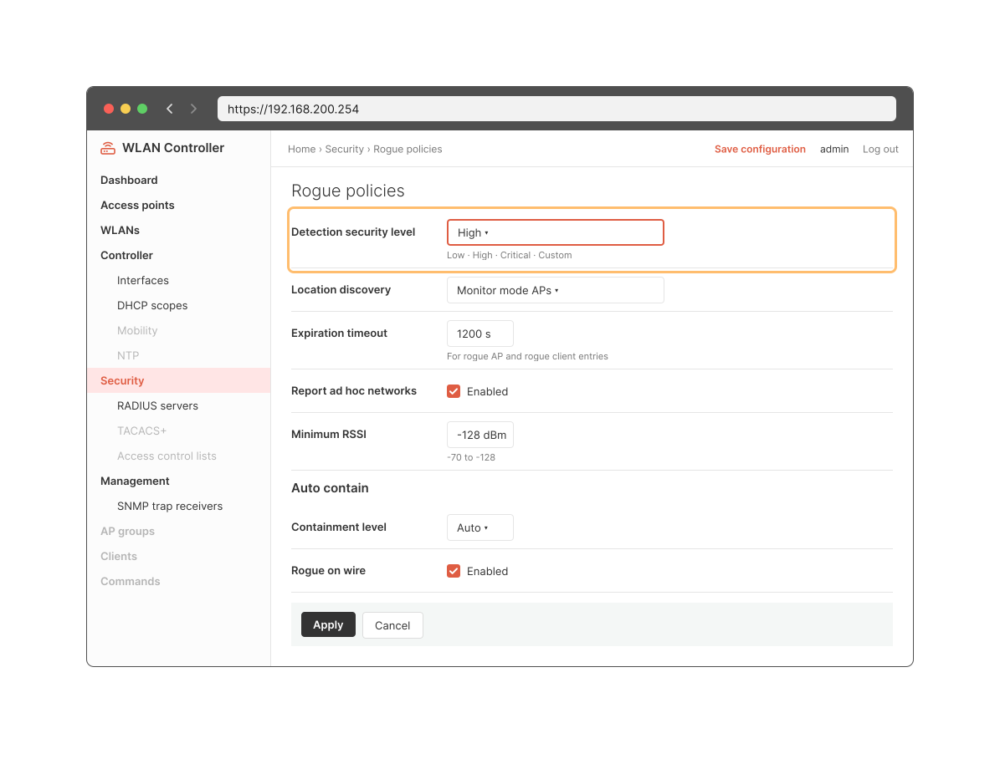

<!-- 12.6.1 -->
## Защита беспроводной сети

Предыдущие темы охватывали компоненты и конфигурацию WLAN. Здесь вы узнаете об угрозах безопасности WLAN.

Беспроводную сеть организации защищают проверкой каждого пользователя и наблюдением за эфиром. В примере контроллер WLC с точкой доступа AP1 раздает сеть Corp, защищенную WPA2 Enterprise: имя и пароль каждого пользователя проверяет сервер RADIUS PC-A. PC-B — компьютер администратора, Laptop1 — ноутбук сотрудника. Домашний маршрутизатор WR, ноутбук его владельца Laptop2 и чужой ноутбук Laptop3 служат для проверки защиты.

1. Контроллер WLC управляет точкой доступа AP1, которая раздает сеть Corp с аутентификацией 802.1X; сервер RADIUS — PC-A с адресом 172.16.1.254. Маршрутизатор WR пока выключен и не подключен к сети.
2. В нормальном состоянии в окне «Беспроводная сеть» ноутбука Laptop1 видна одна сеть — Corp. Сеть запрашивает имя и пароль: сотрудник входит своей учетной записью employee1, сервер RADIUS ее принимает, и Laptop1 подключается к Corp (WPA2-Enterprise, AES, адрес 192.168.5.2). На странице **Dashboard** веб-интерфейса контроллера (https://192.168.200.254) плитка **Rogues** — чужие точки доступа в эфире — показывает 0 APs.
3. Проверка: маршрутизатор WR подключают портом Internet к свободному порту доступа Fa0/2 коммутатора S1 и включают. WR получает адрес от R1 и выходит в эфир с открытой сетью Default. Контроллер замечает чужую точку доступа: плитка **Rogues** показывает 1 APs. Чужой ноутбук Laptop3 подключается к Default без ключа и получает адрес 192.168.0.101 от WR; команда **ping 172.16.1.254** до сервера RADIUS проходит — через NAT маршрутизатора WR чужой ноутбук попал в сеть в обход контроллера. Владелец WR скрывает имя сети (параметр **Hide ESSID**): Default пропадает из списка сетей Laptop3, но Laptop3 остается подключенным — имя сети передается в кадрах клиентов. Затем владелец включает фильтр MAC-адресов (**Allow listed only**, разрешен только адрес Laptop2 0060.2f4a.1b02), и WR отключает Laptop3. Но MAC-адрес передается открыто в каждом кадре: разрешенный адрес легко подсмотреть и подставить.
4. Защита. Кабель WR отключают от S1. Пока WR в эфире, плитка **Rogues** по-прежнему показывает 1 APs: контроллер учитывает точки доступа, которые слышит, а клиенты могут подключиться к такой точке по ошибке. WR выключают, и после обновления страницы **Dashboard** плитка показывает 0 APs. Сеть Corp остается на WPA2 Enterprise: у каждого пользователя своя учетная запись.
5. Та же проверка: в эфире у Laptop3 только Corp. Без имени и пароля подключиться к ней нельзя, а вход с именем guest и чужим паролем сервер RADIUS 172.16.1.254 отклоняет. Laptop1 по-прежнему подключен к Corp со своей учетной записью.
6. Итог: чужую точку доступа контроллер показывает на плитке **Rogues**, и ее убирают из эфира. Скрытый SSID и фильтр MAC-адресов сеть не защищают: имя сети и MAC-адреса видны в кадрах. Защита — WPA2 Enterprise с проверкой каждого пользователя на сервере RADIUS.

<!-- 12.6.2 -->
## Обзор безопасности беспроводной сети

В диапазоне действия точки доступа WLAN открыта для всех, кто обладает соответствующими учетными данными, посредством которых выполняется ассоциация с точкой доступа. Обладая беспроводным сетевым адаптером и знанием приемов взлома, злоумышленник может не присутствовать физически в том месте, где находится WLAN, чтобы получить к ней доступ.

Атаки могут инициироваться посторонними людьми и недовольными сотрудниками, но помимо подобных недоброжелателей ее может ненамеренно спровоцировать любой сотрудник. Беспроводные сети особенно подвержены следующим угрозам:

* **перехват данных** (беспроводные данные должны быть зашифрованы для предотвращения их перехвата);
* **беспроводные нарушители** (неавторизованные пользователи, пытающиеся получить доступ к сетевым ресурсам, могут быть исключены с помощью эффективных методов аутентификации);
* **атаки типа «отказ в обслуживании» (DoS)** (доступ к услугам WLAN может быть скомпрометирован случайно или намеренно, существуют различные решения в зависимости от источника атаки);
* **вредоносные точки доступа** (несанкционированные точки доступа, установленные пользователями без злого умысла или с таковым, можно обнаружить с помощью программного обеспечения для управления).

<!-- 12.6.3 -->
## Атаки типа «отказ в обслуживании» (DoS-атаки)

Ниже приведены причины возникновения DoS-атаки на беспроводную сеть.

* **Неправильно настроенные устройства.** Ошибки конфигурации могут отключить WLAN. Например, администратор может случайно изменить конфигурацию и отключить сеть, либо злоумышленник с правами администратора может сделать это намеренно.
* **Пользователь, преднамеренно вмешивающийся в беспроводную связь.** Злоумышленник намерен отключить беспроводную сеть целиком или до точки, где никакое законное устройство не может получить доступ к среде.
* **Случайные помехи.** WLAN подвержены помехам от других беспроводных устройств, включая микроволновые печи, беспроводные телефоны, радионяни и многое другое. Например, радиотелефон и микроволновая печь, стоящие рядом с беспроводным маршрутизатором, излучают в пределах зоны его покрытия. Полоса 2,4 ГГц в большей степени подвержена воздействию помех, чем полоса 5 ГГц.

Чтобы минимизировать риск DoS-атаки из-за неправильно настроенных устройств и злонамеренных атак, укрепите все устройства, сохраните пароли в безопасности, создайте резервные копии и убедитесь, что все изменения конфигурации внесены в нерабочее время.

Контролируйте WLAN на предмет любых случайных помех и устраняйте их по мере их появления. Поскольку полоса 2,4 ГГц используется другими типами устройств, 5 ГГц следует использовать в областях, подверженных помехам.

<!-- 12.6.4 -->
## Вредоносные точки доступа

**Вредоносная точка доступа** – это точка доступа или беспроводной маршрутизатор, который был подключен к корпоративной сети без явного разрешения и противоречит корпоративной политике. Любой, имеющий доступ к помещению, может установить (намеренно или нет) недорогой беспроводной маршрутизатор, который потенциально может предоставить доступ к защищенному сетевому ресурсу.

После подключения точка доступа может использоваться злоумышленником для захвата MAC-адресов и пакетов данных, получения доступа к сетевым ресурсам или запуска атаки «человек посередине».

Точка доступа персональной сети также может использоваться в качестве вредоносной. Например, пользователь, имеющий защищенный доступ к сети, настраивает свой авторизованный узел Windows как точку доступа к сети Wi-Fi. При этом несанкционированные устройства обходят меры безопасности и получают доступ к ресурсам сети как одно общее устройство.

Чтобы предотвратить установку вредоносных AP, организации должны настроить на WLC политики обнаружения вредоносных AP (например, уровень безопасности обнаружения, обнаружение точками доступа в режиме мониторинга и автоматическое подавление вредоносных точек доступа в проводной сети) и использовать программное обеспечение для активного мониторинга радиочастотного спектра для неавторизованных AP.

<!-- 12.6.5 -->
## Атака с перехватом

При атаке через посредника злоумышленник располагается между двумя проверенными объектами, чтобы читать, изменять или перенаправлять данные, которыми они обмениваются. Существует множество способов создания атаки с перехватом.

Популярная беспроводная атака MITM называется атакой «злой близнец AP», когда злоумышленник вводит мошенническую точку доступа и настраивает ее с тем же SSID, что и у законной. Например, в кафе злоумышленник запускает на своем ноутбуке точку доступа с SSID сети кафе и открытой аутентификацией. Места, предлагающие бесплатный Wi-Fi, такие как аэропорты, кафе и рестораны, являются особенно популярными местами для этого типа атак благодаря открытой аутентификации.

Беспроводные клиенты, пытающиеся подключиться к WLAN, увидят две точки доступа с одинаковым SSID, предлагающие беспроводной доступ. Те, кто находится рядом с вредоносной точкой доступа, находят более сильный сигнал и, скорее всего, ассоциируются с ним. Пользовательский трафик теперь отправляется вредоносной точке доступа, которая, в свою очередь, собирает данные и направляет их на легитимную точку: ноутбук злоумышленника оказывается между ноутбуком пользователя и маршрутизатором кафе. Обратный трафик от законной точки отправляется вредоносной, захватывается, а затем пересылается ничего не подозревающему пользователю. Злоумышленник может украсть пароли пользователя, личную информацию, получить доступ к его устройству и поставить под угрозу систему.

Успешность предотвращения атаки с перехватом зависит от сложности инфраструктуры WLAN и тщательности мониторинга сети. Процесс начинается с определения санкционированных устройств в сети. Для этого пользователи должны пройти аутентификацию. После того, как определены все санкционированные устройства, можно выполнить мониторинг сети на предмет наличия подозрительных устройств или трафика.

<!-- 12.6.6 -->
<!-- quiz -->
