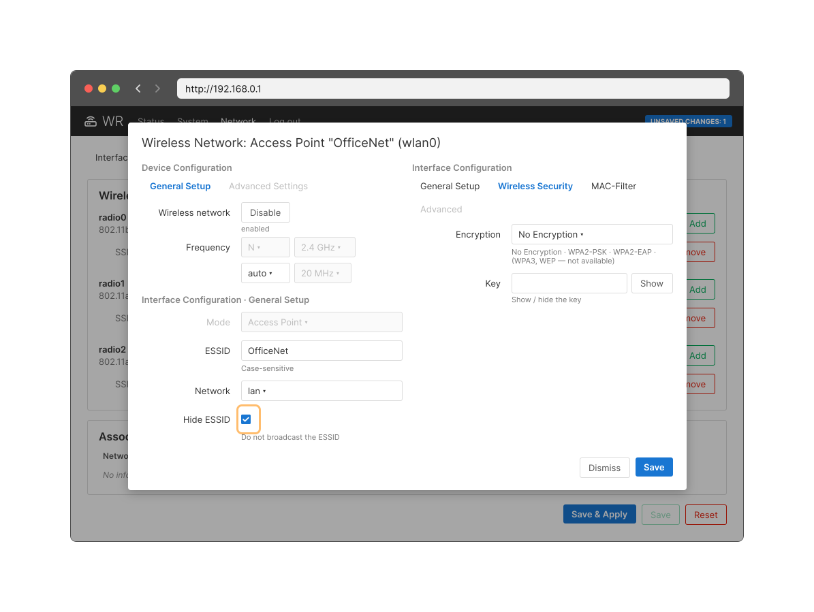
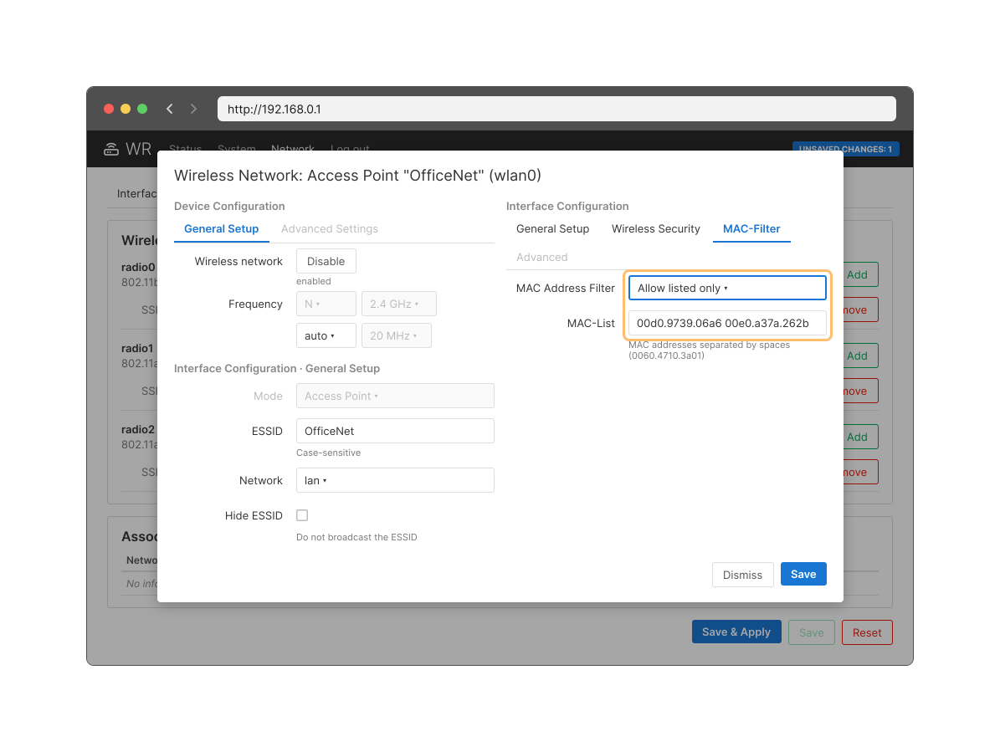
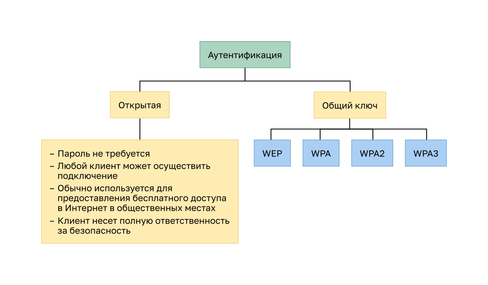
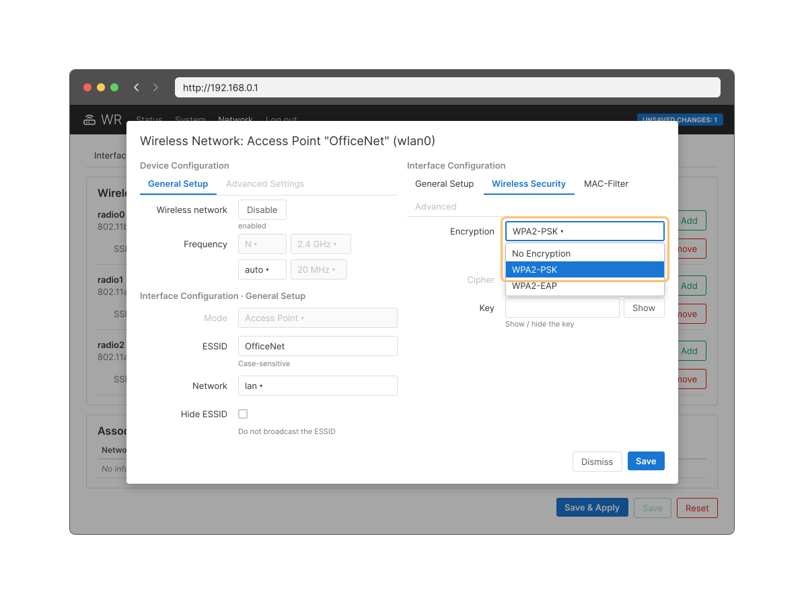
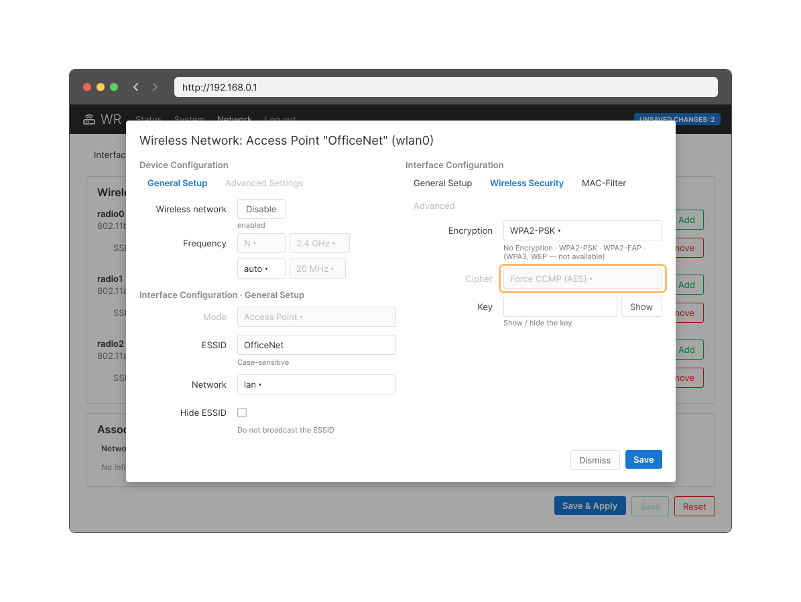
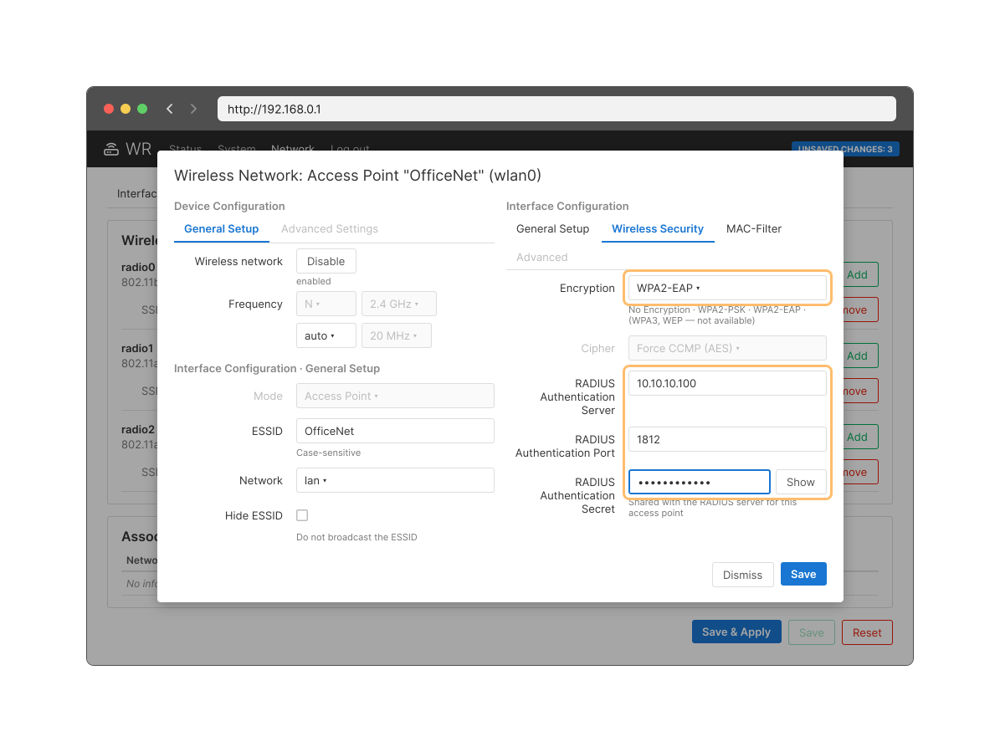

<!-- 12.7.1 -->
## Видео: безопасность беспроводных сетей

В предыдущей теме объяснялись угрозы безопасности WLAN. Что вы можете сделать, чтобы защитить эту сеть?

Посмотрите видео о методах защиты беспроводных локальных сетей.

<!-- 12.7.2 -->
## Сокрытие SSID и фильтрация MAC-адресов

Сигналы беспроводной связи могут передаваться через твердые препятствия — потолки, полы, стены, за пределы дома или офиса. Без строгих мер безопасности установка сети WLAN сродни повсеместному размещению Ethernet-портов, даже на улице.

Чтобы противостоять угрозам, препятствовать проникновению злоумышленников в беспроводную сеть и защитить данные, изначально использовались две ранние функции безопасности, которые по-прежнему доступны на большинстве маршрутизаторов и точек доступа: **сокрытие SSID** и **фильтрация MAC-адресов**.

**Сокрытие SSID**

AP и некоторые беспроводные маршрутизаторы позволяют отключить рассылку SSID в кадрах-маяках. Например, в настройках беспроводной сети OfficeNet для этого отмечают флажок **Hide ESSID** (не передавать ESSID). Клиенты должны вручную настроить SSID для подключения к сети.

**Фильтрация MAC-адресов**

Администратор может вручную разрешить или запретить клиентам беспроводной доступ на основе их физического аппаратного MAC-адреса. Например, на вкладке **MAC-Filter** маршрутизатор настроен на разрешение только двух MAC-адресов (режим **Allow listed only**): 00d0.9739.06a6 и 00e0.a37a.262b. Устройства с другими MAC-адресами не смогут подключиться к беспроводной сети 2,4 ГГц.

<!-- 12.7.3 -->
## Исходные методы аутентификации 802.11

Хотя эти две функции отсеивают большинство пользователей, на самом деле ни сокрытие идентификатора SSID, ни фильтрация MAC-адресов не помешают умелому взломщику. Имена SSID легко обнаружить даже в том случае, если точки доступа не выполняют их широковещательную рассылку, а MAC-адреса можно подделать. Лучший способ защиты беспроводных сетей — использовать системы аутентификации и шифрования.

В исходном стандарте 802.11 представлено два типа аутентификации.

* **Открытая аутентификация.** Любой беспроводной клиент может подключиться к сети без пароля; её используют только там, где безопасность не имеет значения, например для бесплатного доступа в Интернет в кафе, отелях и удаленных районах. Беспроводной клиент отвечает за обеспечение безопасности, например, использование виртуальной частной сети (VPN) для безопасного подключения. Услуги аутентификации и шифрования VPN выходят за рамки этой темы.

* **Аутентификация с помощью общего ключа.** Предоставляет механизмы аутентификации и шифрования данных, передаваемых между беспроводным клиентом и точкой доступа или маршрутизатором. Однако для подключения необходимо предварительно согласовать пароль между сторонами.

Аутентификация с общим ключом реализуется методами WEP, WPA, WPA2 и WPA3.

<!-- 12.7.4 -->
## Методы аутентификации с общим ключом

Существует четыре метода аутентификации с общим ключом, как описано в таблице. Рекомендуется использовать WPA3, а WPA2 — там, где WPA3 поддерживают не все устройства.

| **Метод аутентификации** | **Описание** |
| --- | --- |
| **Протокол безопасности, аналогичный защите проводной сети (Wired Equivalent Privacy, WEP)** | Исходная спецификация 802.11 для защиты данных шифрованием Rivest Cipher 4 (RC4) со статическим ключом. Ключ не меняется от пакета к пакету, поэтому такую сеть легко взломать. WEP больше не рекомендуется и никогда не должен использоваться |
| **Защищенный доступ к Wi-Fi (WPA)** | Стандарт Wi-Fi Alliance, использующий WEP, но защищающий данные с помощью гораздо более надежного алгоритма шифрования Temporal Key Integrity Protocol (TKIP). TKIP меняет ключ для каждого пакета, что значительно усложняет взлом |
| **WPA2** | WPA2 является текущим отраслевым стандартом для защиты беспроводных сетей. Он использует расширенный стандарт шифрования (AES). AES в настоящее время считается самым надежным вариантом |
| **WPA3** | Следующее поколение безопасности Wi-Fi. Все устройства с поддержкой WPA3 используют новейшие методы обеспечения безопасности, запрещают устаревшие протоколы и требуют использования защищенных кадров управления (PMF). С 2020 года поддержка WPA3 обязательна для сертификации устройств Wi-Fi |

<!-- 12.7.5 -->
## Аутентификация домашнего пользователя

Домашние маршрутизаторы обычно имеют два варианта аутентификации: WPA и WPA2 (сильнейший из них). Для WPA2 можно выбрать один из двух методов аутентификации.

* **Персональный** предназначен для домашней или небольшой офисной сети, пользователи проходят аутентификацию с использованием заранее согласованного ключа (PSK, pre-shared key). Беспроводные клиенты проходят проверку подлинности на маршрутизаторе по заранее заданному общему паролю. Специализированный сервер аутентификации не требуется.
* **Корпоративный** предназначен для корпоративных сетей, но для него требуется сервер аутентификации RADIUS (Remote Authentication Dial-In User Service). Хотя этот тип более сложен для настройки, он обеспечивает повышенную безопасность. Устройство проходит аутентификацию на сервере RADIUS, а пользователи — по стандарту 802.1X с расширяемым протоколом аутентификации EAP (Extensible Authentication Protocol).

Например, администратор настраивает беспроводной маршрутизатор с персональной аутентификацией WPA2 в диапазоне 2,4 ГГц: на вкладке **Wireless Security** в списке **Encryption** выбирает **WPA2-PSK** (другие варианты — **No Encryption** и **WPA2-EAP**) и задает ключ в поле **Key**.

<!-- 12.7.6 -->
## Методы шифрования

Шифрование используется для защиты данных. Если злоумышленник выполнил захват зашифрованных данных, он не сможет их расшифровать за короткий срок.

Стандарты WPA и WPA2 используют следующие протоколы шифрования:

* **протокол целостности временного ключа (TKIP)** (метод шифрования, используемый WPA, который обеспечивает поддержку предыдущих версий оборудования WLAN за счет устранения исходных уязвимостей, характерных для метода шифрования 802.11 WEP, и использует WEP, но шифрует полезную нагрузку уровня 2 с помощью TKIP и проверяет целостность сообщения (MIC) в зашифрованном пакете, чтобы убедиться, что оно не было изменено);
* **расширенный стандарт шифрования (AES)** (метод шифрования, используемый WPA2, который является предпочтительным, потому что гораздо более надежен и использует протокол CCMP (режим счетчика с кодом аутентификации сообщений CBC-MAC), позволяющий узлам назначения распознавать, были ли изменены зашифрованные и незашифрованные биты).

Например, после выбора **WPA2-PSK** в списке **Encryption** поле **Cipher** беспроводного маршрутизатора показывает **Force CCMP (AES)**: в диапазоне 2,4 ГГц используется WPA2 с шифрованием AES.

<!-- 12.7.7 -->
## Аутентификация на корпоративном уровне

В сетях, к которым предъявляются более строгие требования в отношении безопасности, для предоставления беспроводным клиентам доступа требуется дополнительная аутентификация или вход в систему. Для выбора режима безопасности Enterprise требуется сервер RADIUS для аутентификации, авторизации и учета (AAA).

* **IP-адрес сервера RADIUS** — это доступный адрес сервера RADIUS.
* **Номера портов UDP** — официально назначенные порты UDP 1812 для аутентификации RADIUS и 1813 для учета RADIUS, но также могут работать с использованием портов UDP 1645 и 1646.
* **Общий ключ** — используется для аутентификации AP на сервере RADIUS.

Например, администратор настраивает беспроводной маршрутизатор с аутентификацией WPA2 Enterprise (в списке **Encryption** — **WPA2-EAP**) с использованием шифрования AES. Также настроены IPv4-адрес сервера RADIUS (10.10.10.100), порт аутентификации 1812 и надежный общий ключ между маршрутизатором и сервером RADIUS.

Общий ключ не является параметром, который должен быть настроен на беспроводном клиенте. Его настройка требуется только на точке доступа, чтобы выполнить аутентификацию с помощью сервера RADIUS. Аутентификация и авторизация пользователей обрабатываются стандартом 802.1X, который обеспечивает централизованную серверную аутентификацию конечных пользователей.

При входе в систему по стандарту 802.1X для обмена данными с точкой доступа и сервером RADIUS используется протокол EAP. EAP представляет собой платформу для аутентификации доступа к сети. Он может обеспечить механизм безопасной аутентификации и согласовать защищенный закрытый ключ, который затем может быть использован для сеанса беспроводного шифрования с использованием шифрования TKIP или AES.

<!-- 12.7.8 -->
## WPA3

Wi-Fi Alliance представил WPA3 в 2018 году, и с июля 2020 года его поддержка обязательна для устройств, проходящих сертификацию Wi-Fi CERTIFIED. WPA2 больше не считается достаточно безопасным, поэтому WPA3 является рекомендуемым методом аутентификации 802.11. Он включает в себя четыре функции:

* WPA3-Personal;
* WPA3-Enterprise;
* открытые сети;
* Интернет вещей (IoT).

В **WPA3-Personal** злоумышленники могут прослушивать контакт между беспроводным клиентом и точкой доступа и использовать атаку методом грубой силы, чтобы попытаться угадать PSK. WPA3-Personal предотвращает эту атаку с помощью одновременной аутентификации равных (SAE), функции, указанной в IEEE 802.11-2016. PSK никогда не раскрывается, и злоумышленник не может его подобрать.

**WPA3-Enterprise** по-прежнему использует аутентификацию 802.1X/EAP. Однако это требует задействовать 192-битный криптографический набор и исключает смешивание протоколов безопасности для предыдущих стандартов 802.11. WPA3-Enterprise придерживается пакета коммерческих алгоритмов национальной безопасности (CNSA), который обычно используется в сетях Wi-Fi с высоким уровнем безопасности.

**Открытые сети** в WPA2 отправляют пользовательский трафик открытым текстом без проверки подлинности. В WPA3 открытые или общедоступные сети Wi-Fi по-прежнему не используют аутентификацию. Однако они используют Opportunistic Wireless Encryption (OWE) для шифрования всего беспроводного трафика.

Хотя WPA2 включал в себя Wi-Fi Protected Setup (WPS) для быстрой настройки встроенных устройств без предварительной их настройки, WPS уязвим для различных атак и не рекомендуется для использования. Кроме того, устройства **IoT**, как правило, являются автономными, то есть у них нет встроенного графического интерфейса для настройки. Им необходим любой простой способ подключения к беспроводной сети. Протокол обеспечения устройств (DPP) был разработан для удовлетворения этой потребности. У каждого такого устройства открытый ключ зашит в прошивку. Ключ обычно проставляется на внешней стороне устройства или его упаковки в виде QR-кода. Сетевой администратор может отсканировать его и быстро ввести в сеть устройство. Хотя это и не является строго частью стандарта WPA3, DPP со временем заменит WPS.

<!-- 12.7.9 -->
<!-- quiz -->
