<!-- 13.1.1 -->
## Настройка беспроводной сети

Беспроводной маршрутизатор WR работает с настройками «из коробки»: IP-адрес 192.168.0.1, служба DHCP и открытые беспроводные сети. К нему кабелем подключен компьютер Admin, ноутбук Laptop1 — беспроводной клиент.

1. В браузере на Admin вводится IP-адрес маршрутизатора по умолчанию — 192.168.0.1. Страница **Authorization Required** запрашивает имя пользователя (admin) и пароль. Пароль администратора еще не задан, и маршрутизатор предупреждает об этом: веб-интерфейс открыт любому, кто знает адрес.
2. В разделе **System → Administration**, на вкладке **Router Password**, пароль администратора вводится дважды и сохраняется кнопкой **Save**. После выхода (**Log out**) маршрутизатор снова запрашивает авторизацию, и вход выполняется с новым паролем.
3. В разделе **Network → Interfaces** для LAN вместо 192.168.0.1 задается частный адрес 10.10.10.1. **Save** сохраняет изменение, а **Save & Apply** применяет его: браузер теряет доступ к маршрутизатору по старому адресу.
4. Команда **ipconfig /renew** в командной строке Admin обновляет IP-адрес: компьютер получает по DHCP адрес из новой сети — 10.10.10.100 со шлюзом 10.10.10.1. Вход в маршрутизатор выполняется по новому адресу, http://10.10.10.1.
5. В разделе **Network → Wireless** видны три радиомодуля, на каждом открытая сеть Default без шифрования. Для сети 2,4 ГГц задаются режим N и канал 6 (каналы 1, 6 и 11 не перекрываются), SSID **OfficeNet**, режим безопасности **WPA2-PSK** с шифром **Force CCMP (AES)** и парольная фраза.
6. Радиомодули 5 ГГц с открытыми сетями Default отключаются (**Disable**). **Save & Apply** применяет все четыре изменения сразу.
7. На Laptop1 в списке беспроводных сетей выбирается OfficeNet (канал 6, WPA2-Personal) и вводится ключ сети: ноутбук подключается и получает по DHCP адрес 10.10.10.101.

<!-- 13.1.2 -->
## Беспроводной маршрутизатор

Удаленные работники, небольшие филиалы и домашние сети часто используют небольшой офис и домашний маршрутизатор. Эти устройства иногда называют маршрутизаторами с интегрированными сервисами, потому что они обычно включают в себя коммутатор для проводных клиентов, порт для подключения к Интернету (иногда помеченный как WAN) и беспроводные компоненты для беспроводного доступа клиентов. Например, на задней панели такого маршрутизатора находятся четыре порта LAN встроенного коммутатора и порт WAN с надписью Internet для подключения к модему провайдера, а антенны относятся к встроенной точке доступа Wi-Fi. В остальной части этого модуля небольшие офисные и домашние маршрутизаторы называются беспроводными.

**Беспроводной маршрутизатор**

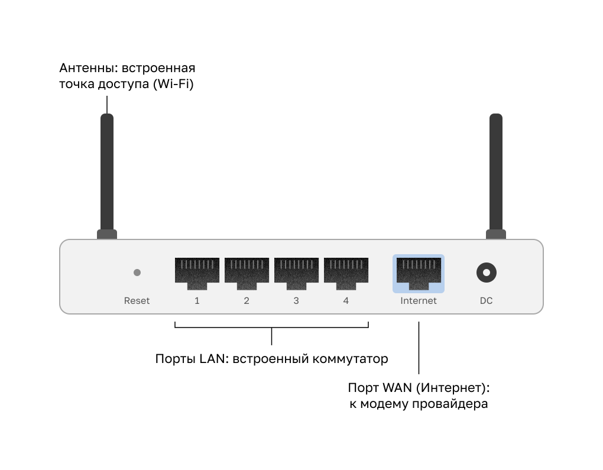

Обычно проводной компьютер подключается к беспроводному маршрутизатору, а маршрутизатор — к кабельному или DSL-модему, через который он выходит в Интернет.

Эти беспроводные маршрутизаторы обычно обеспечивают безопасность WLAN, службы DHCP, встроенную трансляцию имен (NAT), качество обслуживания (QoS), а также ряд других функций. Набор функций зависит от модели устройства.

**Примечание.** Конфигурирование кабельного или DSL-модема обычно выполняется представителем поставщика услуг на месте, либо удаленно через пошаговое руководство с вами по телефону. Если вы покупаете модем, он будет поставляться с документацией о том, как подключить его к вашему поставщику услуг, что, скорее всего, будет включать обращение к вашему поставщику услуг для получения дополнительной информации.

<!-- 13.1.3 -->
## Вход на беспроводной маршрутизатор

Большинство домашних беспроводных маршрутизаторов для небольших офисов готовы к работе сразу «из коробки». Они предварительно настроены для подключения к сети и предоставления услуг. Например, такое устройство использует DHCP для автоматического предоставления адресной информации подключенным компьютерам или смартфонам. Вместе с тем в Интернете легко находятся IP-адреса по умолчанию для беспроводных маршрутизаторов, имена пользователей и пароли. Просто введите такую фразу для поиска, как default wireless router ip address (IP-адрес по умолчанию для беспроводного маршрутизатора) или default wireless router passwords (пароли по умолчанию для беспроводных маршрутизаторов) для отображения списка многих сайтов, которые предоставляют эту информацию. Например, на многих маршрутизаторах и имя пользователя, и пароль по умолчанию — «admin». Таким образом, первоочередной задачей является изменение этих параметров по умолчанию с целью обеспечения безопасности.

Для доступа к графическому пользовательскому интерфейсу настройки беспроводного маршрутизатора откройте браузер. В поле **Address** (адрес) введите частный IP-адрес по умолчанию. IP-адрес по умолчанию можно найти либо в документации, которая поставляется с маршрутизатором, либо в Интернете. Например, это может быть IP-адрес 192.168.0.1 — стандартный адрес по умолчанию у ряда производителей. Страница **Authorization Required** запрашивает имя пользователя и пароль для получения доступа к графическому пользовательскому интерфейсу маршрутизатора. Слово «admin» обычно используется в качестве имени пользователя и пароля по умолчанию. Как и в прошлый раз, сверьтесь с документацией к вашему беспроводному маршрутизатору или поищите в Интернете.

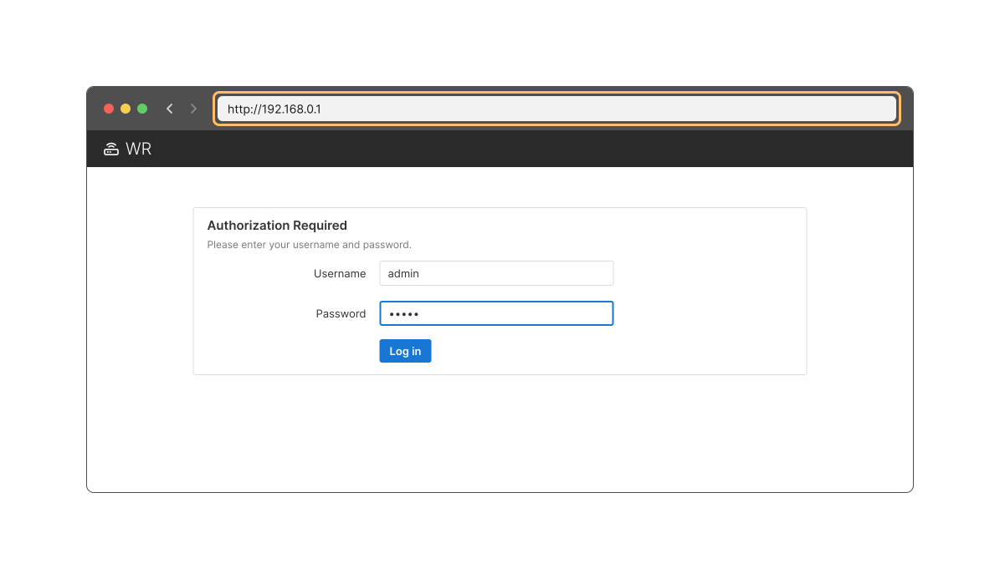

<!-- 13.1.4 -->
## Базовая настройка сети

Базовая настройка сети включает в себя следующие шаги:

1. войдите на маршрутизатор через браузер;
2. измените пароль администратора, заданный по умолчанию;
3. войдите с новым административным паролем;
4. измените диапазон адресов DHCP по умолчанию;
5. обновите IP-адрес;
6. войдите в маршрутизатор с новым IP-адресом.

**1. Войдите на маршрутизатор через браузер.**

После входа в систему открывается графический интерфейс. На экране настройки будет присутствовать вкладки или меню, которые помогут переключаться на различные задачи настройки маршрутизатора. Часто необходимо сохранять параметры, измененные в одном окне, перед переходом в другое. В такой ситуации рекомендуется вносить изменения в параметры по умолчанию.

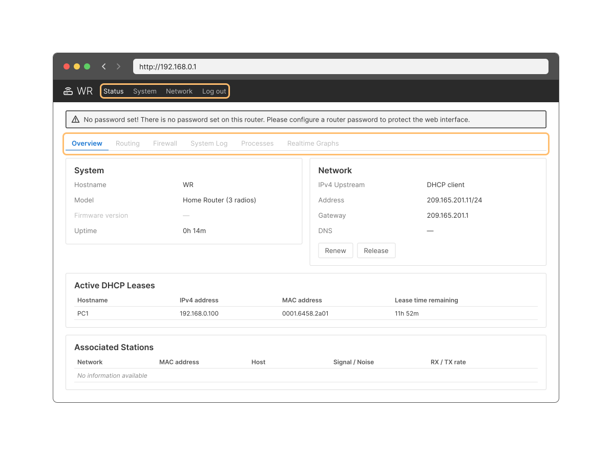

**2. Измените пароль администратора, заданный по умолчанию.**

Чтобы изменить пароль для входа по умолчанию, найдите административную часть графического интерфейса маршрутизатора. В этом примере выбран раздел **System → Administration** (администрирование), вкладка **Router Password**. Здесь пароль устройства можно поменять. Иногда, как в примере, вы можете изменить только пароль. Имя пользователя остается admin или любым другим именем пользователя по умолчанию для маршрутизатора, который вы настраиваете.

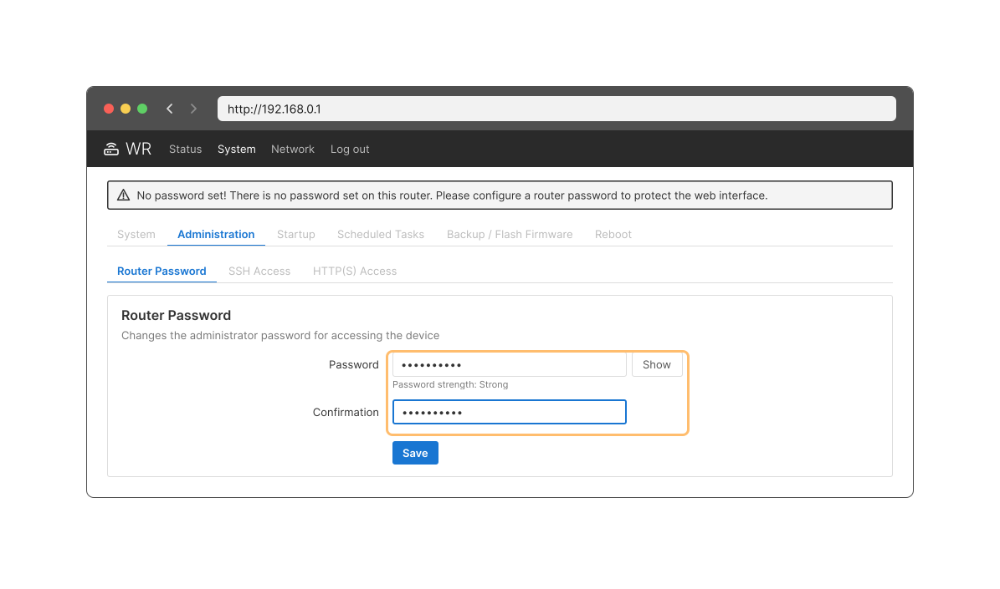

**3. Войдите с новым административным паролем.**

После изменения пароля беспроводной маршрутизатор снова запросит авторизацию. Введите имя пользователя (admin) и новый пароль на странице **Authorization Required**.

**4. Измените диапазон адресов DHCP по умолчанию.**

Измените IPv4-адрес по умолчанию. Рекомендуется использовать частную IP-адресацию внутри своей сети. В примере используется IPv4-адрес 10.10.10.1, но это может быть любой выбранный вами частный адрес.

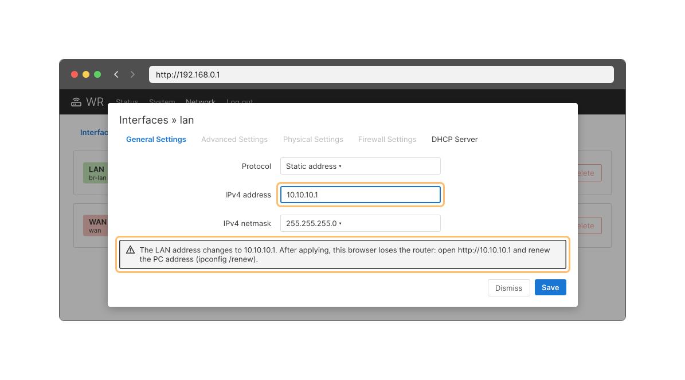

**5. Обновите IP-адрес.**

Нажатие **Save** в окне, а затем **Save & Apply** (сохранить и применить) на странице приведет к временной потере доступа к беспроводному маршрутизатору. Откройте окно командной строки и обновите свой IP-адрес с помощью команды **ipconfig /renew**. Например, компьютер получает от маршрутизатора адрес 10.10.10.100 с маской 255.255.255.0 и шлюзом по умолчанию 10.10.10.1.

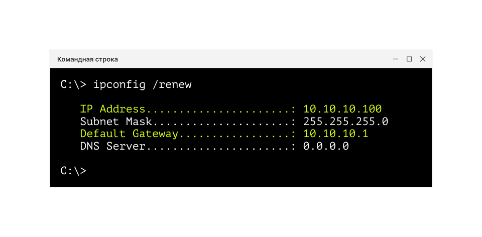

**6. Войдите в маршрутизатор с новым IP-адресом.**

Введите в браузере новый IP-адрес (http://10.10.10.1), чтобы восстановить доступ к графическому интерфейсу конфигурации маршрутизатора. Теперь вы готовы продолжить настройку устройства для беспроводного доступа.

<!-- 13.1.5 -->
## Базовая настройка беспроводной сети

Базовая настройка беспроводной сети включает в себя следующие шаги:

1. просмотр настроек WLAN по умолчанию;
2. изменение режима сети;
3. настройка идентификатора SSID;
4. конфигурация канала;
5. конфигурация режима безопасности;
6. настройка парольной фразы.

**1. Просмотр настроек WLAN по умолчанию.**

Из коробки беспроводной маршрутизатор обеспечивает доступ к устройствам, используя имя и пароль сети по умолчанию. Имя беспроводной сети называется ее идентификатором (SSID). Найдите основные параметры этой сети для вашего маршрутизатора, чтобы изменить эти значения по умолчанию. Например, на вкладке **Wireless** раздела **Network** у маршрутизатора три радиомодуля: radio0 (802.11bgn, 2,4 ГГц, канал 6), radio1 (802.11ac, 5 ГГц, канал 36) и radio2 (802.11ac, 5 ГГц, канал 149). У всех трех WLAN SSID по умолчанию — «Default», шифрование не настроено.

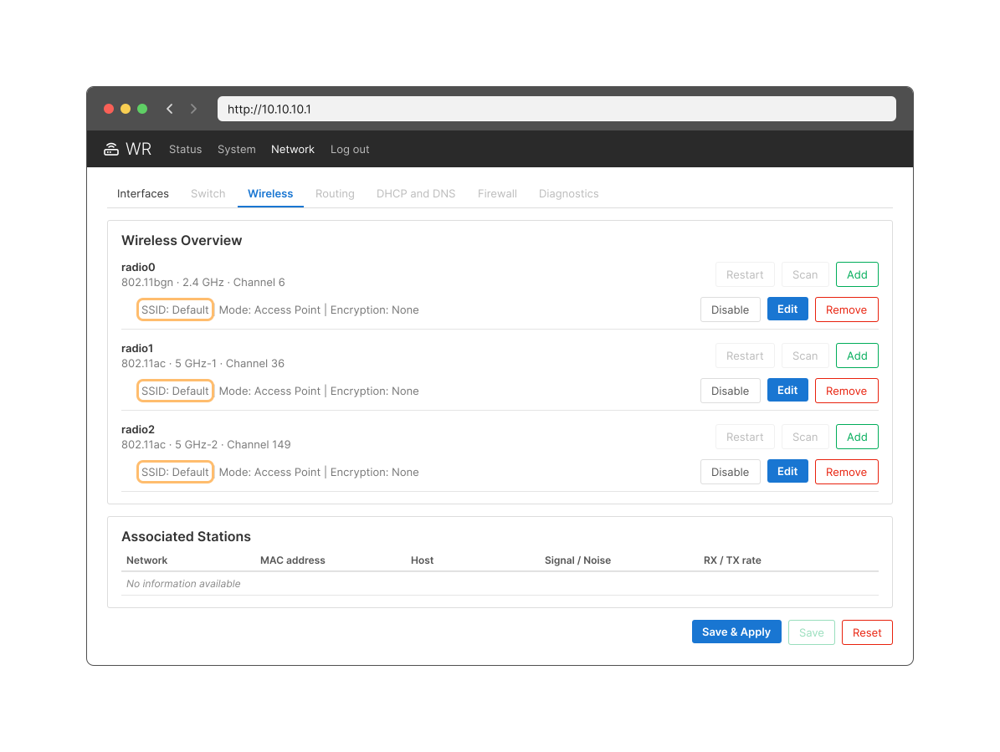

**2. Изменение режима сети.**

Некоторые беспроводные маршрутизаторы позволяют выбирать, какой стандарт 802.11 следует поддерживать. Пример показывает, что был выбран «Legacy». Это означает, что во всех беспроводных устройствах, которые подключаются к маршрутизатору, должны быть установлены сетевые платы. Современные беспроводные маршрутизаторы, настроенные для устаревшего или смешанного режима, скорее всего поддерживают сетевые адаптеры 802.11a, 802.11n и 802.11ac.

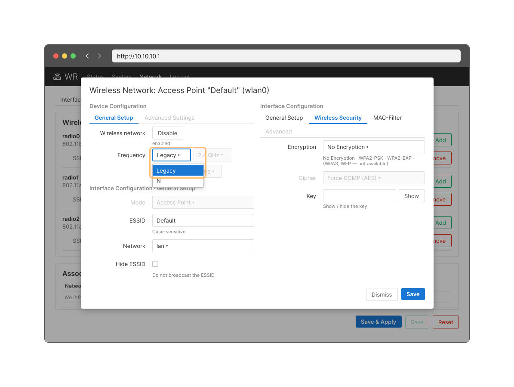

**3. Настройка идентификатора SSID.**

Назначьте SSID для WLAN. OfficeNet используется в примере для всех трех WLAN. Беспроводной маршрутизатор объявляет о своем присутствии посредством выполнения широковещательной рассылки его SSID. Это позволяет беспроводным узлам автоматически обнаруживать имя сети. Если широковещательная рассылка SSID отключена, на беспроводных устройствах необходимо вводить его вручную.

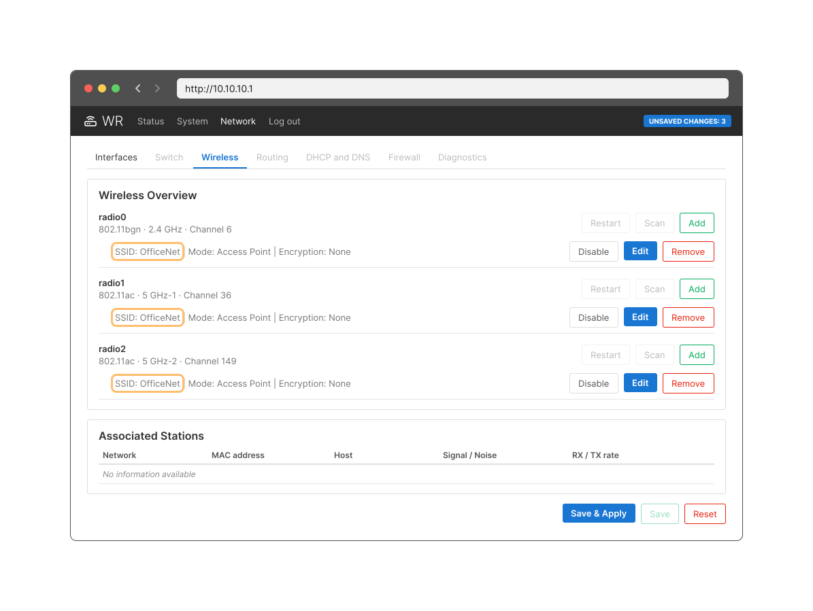

**4. Конфигурация канала.**

Устройства, настроенные с одним и тем же каналом в диапазоне 2,4 ГГц, могут перекрываться и вызывать искажения, снижая производительность беспроводной связи и потенциально нарушая сетевые подключения. Решение, позволяющее избежать помех, заключается в настройке непересекающихся каналов на беспроводных маршрутизаторах и точках доступа, которые находятся рядом друг с другом. В частности, каналы 1, 6 и 11 не перекрываются. В этом примере устройство настроено на использование канала 6.

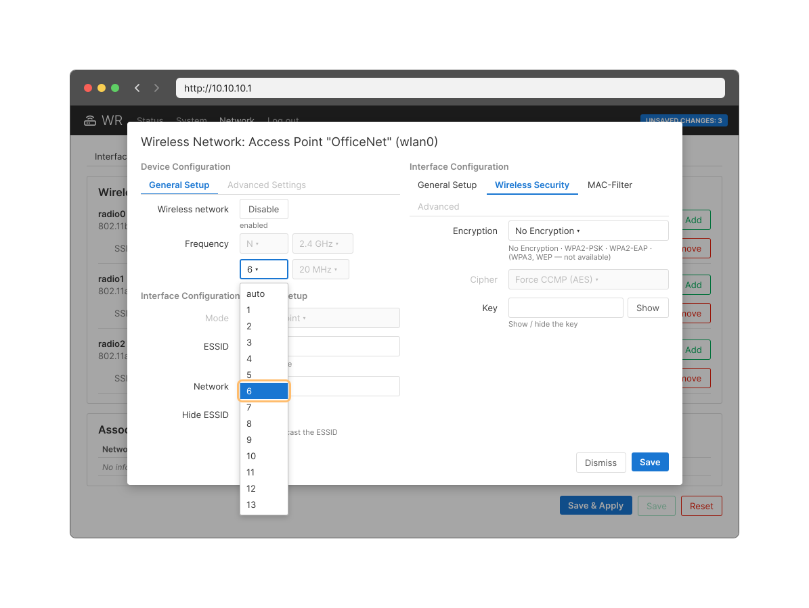

**5. Конфигурация режима безопасности.**

Изначально на беспроводном маршрутизаторе может быть не настроена защита WLAN. В этом примере персональная версия защищенного доступа Wi-Fi версии 2 (WPA2 Personal) (в интерфейсе — **WPA2-PSK**, шифр **Force CCMP (AES)**) выбрана для всех трех WLAN. WPA2 с расширенным стандартом шифрования (AES) в настоящее время является самым надежным режимом безопасности.

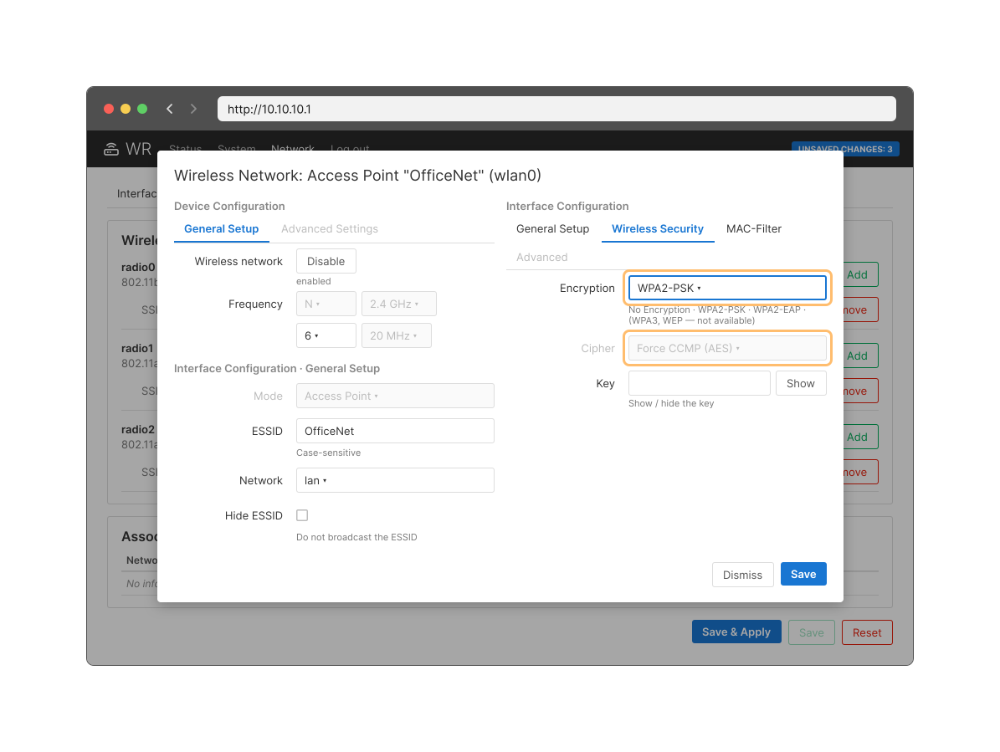

**6. Настройка парольной фразы.**

Персональный WPA2 использует идентификационную фразу для аутентификации беспроводных клиентов. Его легче использовать в небольшом офисе или дома, поскольку он не требует сервера аутентификации. Более крупные организации внедряют WPA2 для предприятий и требуют, чтобы беспроводные клиенты проходили аутентификацию с использованием имени пользователя и пароля.

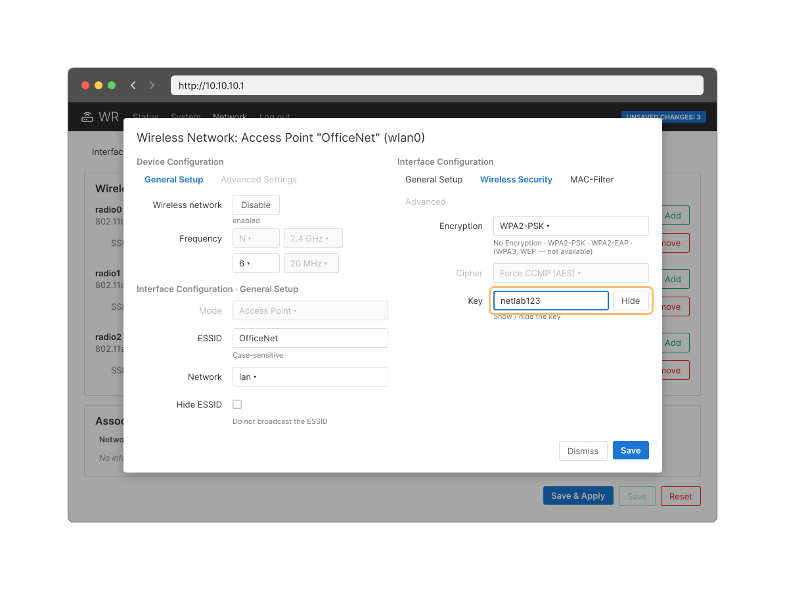

<!-- 13.1.6 -->
## Настройка беспроводной ячеистой сети

В небольшом офисе или домашней сети одного беспроводного маршрутизатора может быть достаточно для обеспечения доступа ко всем клиентам. Однако, если вы хотите расширить радиус действия примерно на 45 метров в помещении и на 90 метров на улице, вы можете добавить точки доступа. Например, в беспроводной ячеистой сети к беспроводному маршрутизатору по беспроводной связи подключена точка доступа 1, а к ней — точка доступа 2. Обе точки доступа настроены с той же конфигурацией WLAN, что и маршрутизатор (SSID OfficeNet). Обратите внимание, что для них выбраны каналы 1 и 11, чтобы точки доступа не мешали каналу 6 маршрутизатора.

Расширение WLAN в небольшом офисе или дома становится все проще. Производители сделали создание беспроводной ячеистой сети (WMN) простым с помощью приложений для смартфонов. Вы покупаете систему, расставляете точки доступа, подключаете их, загружаете приложение и настраиваете свой WMN за несколько шагов. Поищите в Интернете «лучшую сетевую систему Wi-Fi», чтобы найти обзоры текущих предложений.

<!-- 13.1.7 -->
## NAT для IPv4

На странице состояния беспроводного маршрутизатора можно найти информацию об IPv4-адресации, которую устройство использует для отправки данных в Интернет. Например, маршрутизатор получил от провайдера по DHCP адрес 209.165.201.11/24 со шлюзом 209.165.201.1, а компьютерам локальной сети выдал адреса 10.10.10.100 (PC1) и 10.10.10.101 (Laptop1). Обратите внимание, что IPv4-адрес 209.165.201.11 – это сеть, отличная от адреса 10.10.10.1, назначенного интерфейсу локальной сети маршрутизатора. Все устройства в локальной сети получат назначенные адреса с префиксом 10.10.10.

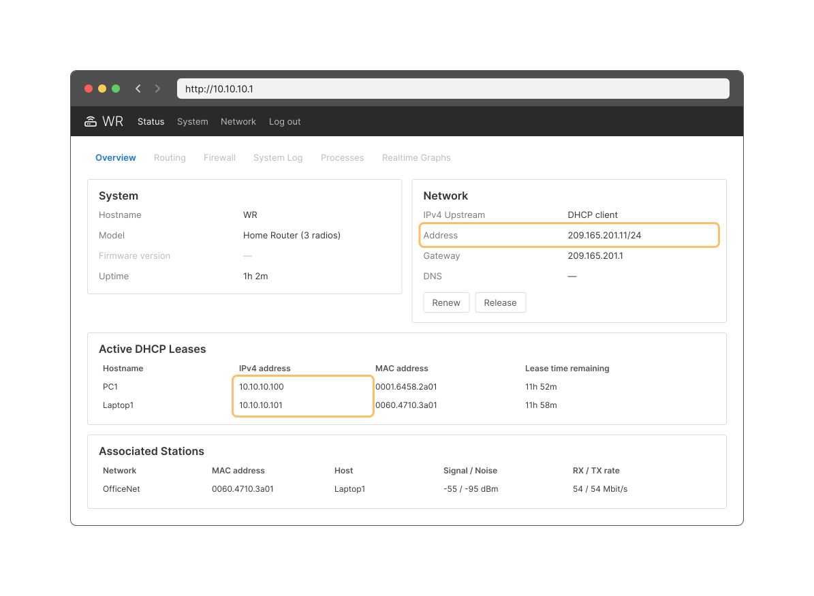

IPv4-адрес 209.165.201.11 общедоступен в Интернете. Любой адрес с цифрой 10 в первом октете является частным и не может быть маршрутизирован в Интернете. Следовательно, маршрутизатор будет реализовывать процесс преобразования частных адресов в маршрутизируемые в Интернете адреса. Этот процесс называется преобразованием сетевых адресов (NAT). NAT обеспечивает преобразование частного (локального) IPv4-адреса источника в публичный (глобальный). Входящие пакеты проходят обратный процесс. Используя NAT, маршрутизатор может преобразовать многие внутренние IP-адреса в общедоступные.

Некоторые интернет-провайдеры используют частную адресацию для подключения к клиентским устройствам. Однако в итоге ваш трафик покинет сеть провайдера и будет маршрутизироваться через Интернет. Чтобы просмотреть IP-адреса для ваших устройств, введите запрос «какой у меня IP-адрес». Сделайте это для других устройств в той же сети, и вы увидите, что все они используют один и тот же общедоступный IPv4-адрес. NAT делает это возможным, отслеживая номера портов источника для каждого сеанса, установленного устройством. Если у вашего интернет-провайдера включен IPv6, вы увидите уникальный IPv6-адрес для каждого устройства.

<!-- 13.1.8 -->
## Гарантированное качество обслуживания

Многие беспроводные маршрутизаторы имеют возможность настройки качества обслуживания (QoS). Можно добавить в сеть инструменты QoS и предоставить некоторым типам трафика, например, голосу и видео, приоритет над трафиком, менее чувствительным к задержкам (электронная почта и просмотр веб-страниц). На некоторых беспроводных маршрутизаторах трафик также может быть приоритетным для определенных портов.

Например, в упрощенном интерфейсе QoS домашнего маршрутизатора правила классификации задают приоритет приложений: IP-телефония, онлайн-игры и потоковое видео получают высокий приоритет, FTP, просмотр веб-страниц (WWW) и исходящая почта (SMTP) — средний, файлообмен P2P — низкий. Когда канал в Интернет загружен, трафик с более высоким приоритетом отправляется первым. Обычно настройки QoS можно найти в расширенных меню. Если у вас есть беспроводной маршрутизатор, проверьте его настройки QoS. Иногда они могут быть перечислены в разделе **«Управление пропускной способностью»** или что-то подобное. Посмотрите документы, прилагавшиеся к устройству при покупке, или поищите в Интернете «параметры qos», чтобы узнать марку и модель вашего маршрутизатора.

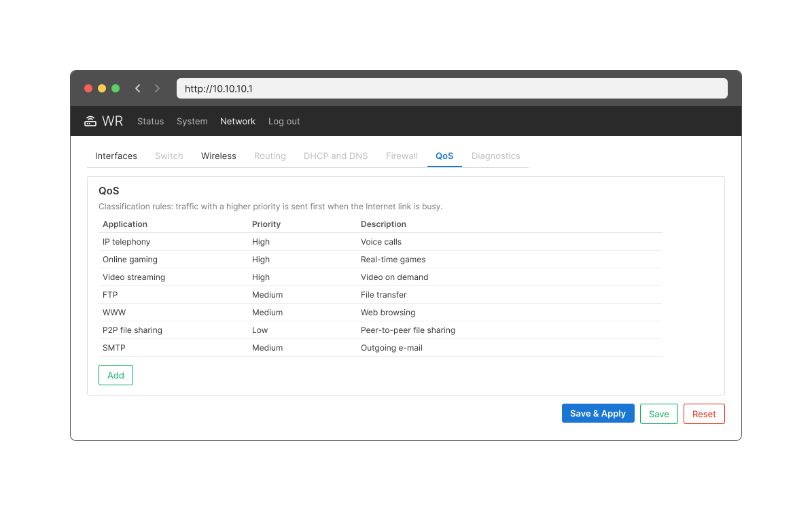

<!-- 13.1.9 -->
## Перенаправление портов

Беспроводные маршрутизаторы обычно блокируют порты TCP и UDP, чтобы предотвратить несанкционированный доступ в локальную сеть и из нее. Однако в некоторых случаях необходимо открыть некоторые порты, чтобы определенные программы и приложения могли связываться с устройствами в других сетях. **Переадресация** (также перенаправление или проброс) **портов** (port forwarding) — это способ направления трафика между устройствами в различных сетях на основе правил.

Когда трафик достигает маршрутизатора, он на основе номера порта, найденного в пакете, определяет, нужно ли пересылать его определенному устройству. Например, маршрутизатор может быть настроен на перенаправление порта 80, который связан с HTTP. Когда устройство получает пакет с портом назначения 80, он пересылает трафик серверу в сети, обслуживающему веб-страницы. Например, на вкладке **Firewall → Port Forwards** маршрутизатора включено правило «Web Server»: трафик TCP из WAN на порт 80 перенаправляется на сервер с IP-адресом 10.10.10.50 в локальной сети, на тот же порт 80.

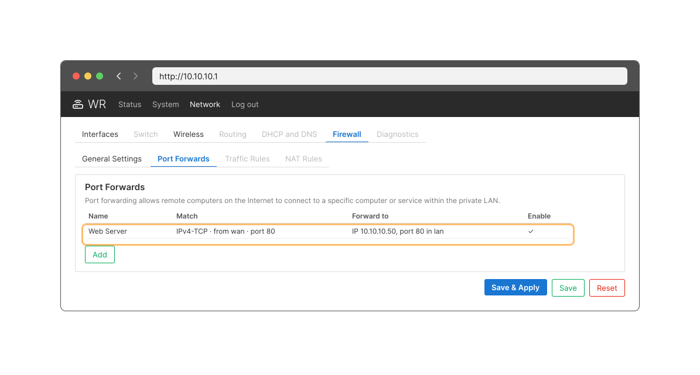

Включение портов (port triggering) позволяет маршрутизатору временно пересылать данные через входящие порты определенному устройству. Включение портов можно использовать для пересылки данных на компьютер, только если назначенный диапазон портов используется для создания исходящего запроса. Например, видеоигра может задействовать порты 27000–27100 для связи с другими игроками. Это запускающие порты. Клиент чата может использовать порт 56 для связи с этими же игроками, чтобы они могли общаться друг с другом. Если в этом примере существует игровой трафик на исходящем порту с диапазоном запускающих портов, входящий трафик чата на порту 56 перенаправляется на компьютер, используемый для видеоигры и общения с друзьями. Когда игра завершается и запускающие порты больше не используются, порту 56 больше не будет разрешено пересылать какой-либо трафик этому компьютеру.
