<!-- 13.2.1 -->
## Видео: конфигурация Базового WLAN с контроллером беспроводной сети

В предыдущей теме вы узнали о конфигурации удаленных возможностей WLAN. Этот раздел о настройке базовой WLAN на WLC.

Посмотрите видео по настройке WLC с базовым WLAN-соединением.


<!-- 13.2.2 -->
## Топология с использованием контроллера беспроводных точек доступа

В этой теме используется следующая топология. Маршрутизатор R1 подключен интерфейсом F0/0 к PC-A (сервер), а интерфейсом F0/1 — к порту F0/5 коммутатора S1. К S1 подключены PC-B (администратор) через порт F0/6, WLC через порт F0/18 (порт G1 контроллера) и точка доступа AP1, которая получает питание по PoE; к AP1 по беспроводной связи подключается ноутбук. Каналы S1 с R1, WLC и AP1 — магистральные 802.1Q. Адреса устройств приведены в таблице. Точка доступа (AP) организована на основе контроллера, а не автономно. Такие устройства не требуют начальной настройки и часто называются облегченными точками доступа (LAP). LAP используют протокол CAPWAP (ранее — LWAPP) для связи с контроллером WLAN (WLC). Точки доступа, управляемые контроллером, рекомендуется использовать в случаях, когда в сети их много. Поскольку добавлено больше AP, каждая из них автоматически настраивается и управляется WLC.

**Топология**


**Точка доступа** – это PoE, что означает, что она подключена к кабелю Ethernet, соединенному с коммутатором.

**Addressing Table**

| Устройство | Интерфейс | IP-адрес | Маска подсети |
| --- | --- | --- | --- |
| R1 | F0/0 | 172.16.1.1 | 255.255.255.0 |
| R1 | F0/1.1 | 192.168.200.1 | 255.255.255.0 |
| S1 | VLAN 1 | DHCP |
| WLC | Управление (Management) | 192.168.200.254 | 255.255.255.0 |
| AP1 | Wired 0 | 192.168.200.3 | 255.255.255.0 |
| ПК-A | Сетевой адаптер | 172.16.1.254 | 255.255.255.0 |
| PC-B | NIC | DHCP |
| Ноутбук с беспроводным подключением | NIC | DHCP |

<!-- 13.2.3 -->
## Вход на WLC

Настройка контроллера беспроводной локальной сети (WLC) не сильно отличается от настройки беспроводного маршрутизатора. Большая разница в том, что WLC контролирует точки доступа и предоставляет больше сервисов и возможностей управления, многие из которых выходят за рамки этого модуля.

**Примечание.** Цифры в этом разделе, которые показывают графический интерфейс пользователя (GUI) и меню, взяты из одной из моделей беспроводного контроллера. Другие модели WLC будут иметь аналогичные меню и функции.

Пользователь входит в WLC через браузер по адресу управления https://192.168.200.254 с учетными данными, которые были настроены во время начальной конфигурации (например, с именем пользователя admin).

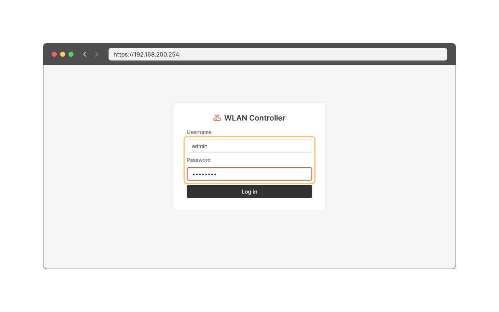

Страница **Dashboard** (панель мониторинга) представляет собой панель мониторинга, которая обеспечивает быстрый обзор количества настроенных беспроводных сетей, связанных точек доступа (AP) и активных клиентов. Вы также можете увидеть количество вредоносных (rogue) точек доступа и клиентов. Например, сразу после входа панель показывает одну подключенную точку доступа (AP1, 192.168.200.3), 0 клиентов, 0 WLAN, а также 51 вредоносную точку доступа и 5 вредоносных клиентов.

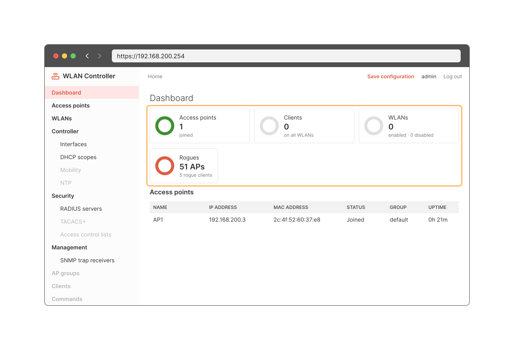

<!-- 13.2.4 -->
## Просмотр всей информации от точках доступа

Нажмите **Access Points** (точки доступа) в левом меню, чтобы просмотреть общее представление о системной информации и производительности точки доступа. AP1 использует адрес 192.168.200.3, подключена к WLC (статус **Joined**) и получает питание по PoE. Поскольку протокол CDP активен в этой сети, WLC знает, что AP подключен к порту FastEthernet 0/1 на коммутаторе.

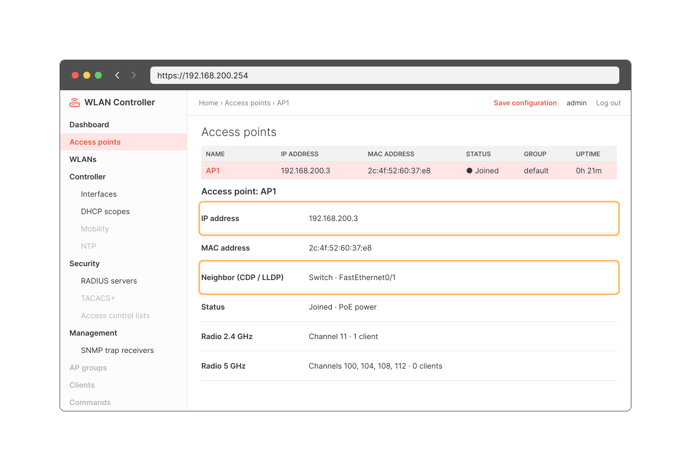

Этот AP в топологии поддерживает командную строку, поэтому вы можете использовать ограниченный набор уже знакомых команд. В этом примере сетевой администратор пропинговал шлюз по умолчанию, WLC и проверил проводной интерфейс.

```
AP1# ping 192.168.200.1
Sending 5, 100-byte ICMP Echos to 192.168.200.1, timeout is 2 seconds
!!!!!
Success rate is 100 percent (5/5), round-trip min/avg/max = 1069812.242/1071814.785/1073817.215 ms
AP1# ping 192.168.200.254
Sending 5, 100-byte ICMP Echos to 192.168.200.254, timeout is 2 seconds
!!!!!
Success rate is 100 percent (5/5), round-trip min/avg/max = 1055820.953/1057820.738/1059819.928 ms
AP1# show interface wired 0
wired0    Link encap:Ethernet  HWaddr 2C:4F:52:60:37:E8
          inet addr:192.168.200.3  Bcast:192.168.200.255  Mask:255.255.255.255
          UP BROADCAST RUNNING PROMISC MULTICAST  MTU:1500  Metric:1
          RX packets:2478 errors:0 dropped:3 overruns:0 frame:0
          TX packets:1494 errors:0 dropped:0 overruns:0 carrier:0
          collisions:0 txqueuelen:80
          RX bytes:207632 (202.7 KiB)  TX bytes:300872 (293.8 KiB)
AP1#
```

<!-- 13.2.5 -->
## Расширенные настройки

Большинство WLC будут поставляться с некоторыми базовыми настройками и меню, к которым пользователи могут быстро получить доступ для реализации различных общих конфигураций. Однако вы, как сетевой администратор, обычно получаете доступ к дополнительным настройкам. Для беспроводного контроллера все функции WLC доступны из меню слева на странице **Dashboard**: **Access points**, **WLANs**, раздел **Controller** (**Interfaces**, **DHCP scopes**), раздел **Security** (**RADIUS servers**), раздел **Management** (**SNMP trap receivers**) и другие.

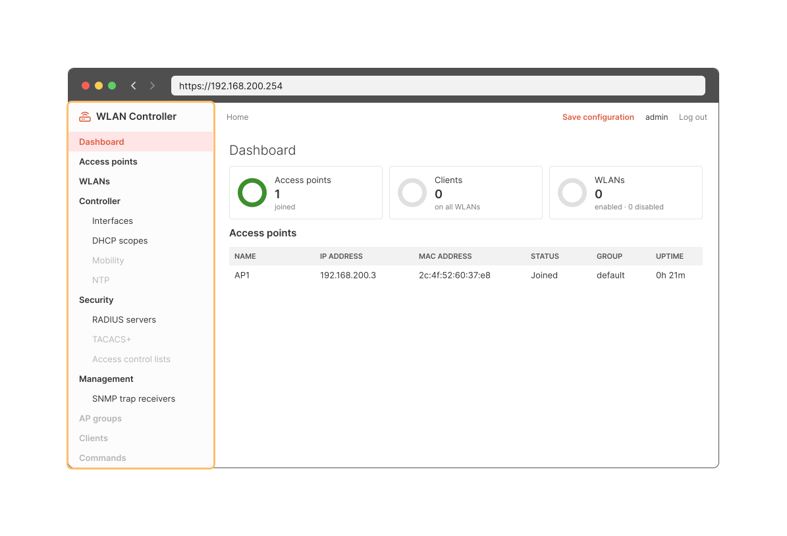

<!-- 13.2.6 -->
## Настройка WLAN

Контроллеры беспроводной локальной сети имеют порты и интерфейсы. **Порты** – это гнезда  для физических подключений к проводной сети. Они напоминают порты коммутатора. **Интерфейсы** – виртуальные. Они созданы программно и очень похожи на интерфейсы VLAN. Фактически, каждый интерфейс, который будет передавать трафик от WLAN, настроен на WLC как другая VLAN. Например, WLC может поддерживать 150 точек доступа и до 4094 VLAN, но иметь только пять физических портов. Так, порт 1 настроен как магистральный: через него проходит трафик интерфейса management без тега и интерфейсов WLAN, таких как user\_wlan и guest\_wlan, каждый в своей VLAN. Это означает, что каждый физический порт может поддерживать множество AP и WLAN. Порты на WLC, по сути, являются магистральными (trunk), которые могут передавать трафик от нескольких VLAN к коммутатору для распределения по нескольким точкам доступа, каждая из которых может поддерживать несколько WLAN.


Базовая конфигурация WLAN на WLC включает следующие шаги:

1. создание WLAN;
2. применение и активация WLAN;
3. выбор интерфейса;
4. настройка безопасности WLAN;
5. проверка того, что WLAN работает;
6. мониторинг WLAN;
7. просмотр информации о беспроводном клиенте.

**1. Создание WLAN**

Администратор нажимает **Add WLAN** на странице **WLANs** и создает новую WLAN с ID 1, которая будет использовать **Wireless\_LAN** в качестве имени профиля (**Profile name**) и идентификатора набора услуг (SSID). Идентификатор является произвольным значением, которое используется для опознавания WLAN в отображении вывода на WLC.

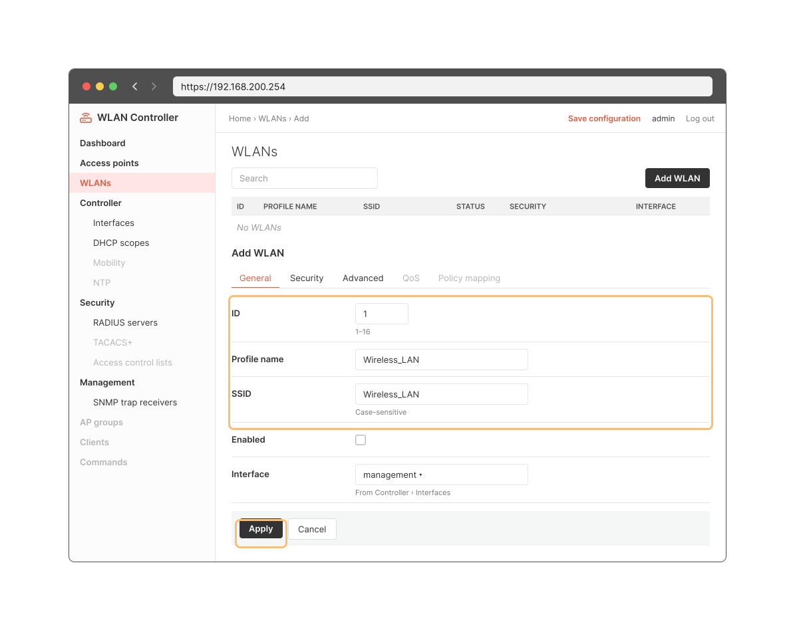

**2. Применение и активация WLAN**

После нажатия кнопки **Apply** (применить) WLAN появляется в списке; щелкните ее строку, чтобы открыть форму **Edit WLAN**. Администратор должен включить WLAN, прежде чем пользователи смогут получить к ней доступ: пока в списке у нее статус **Disabled**. Флажок **Enabled** на вкладке **General** позволяет сетевому администратору настраивать различные функции для WLAN, а также дополнительные WLAN, прежде чем включать их для беспроводного клиентского доступа. Отсюда специалист может настроить различные параметры для WLAN, включая безопасность, QoS, политики и другие дополнительные параметры.

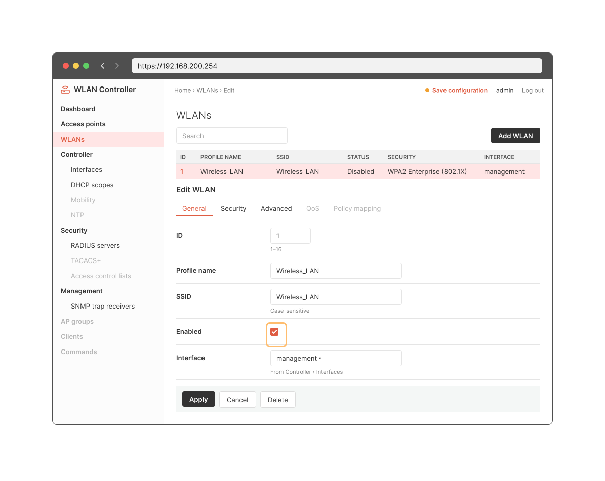

**3. Выбор интерфейса**

Когда вы создаете WLAN, вы должны выбрать интерфейс, который будет передавать трафик сети. Например, в форме **Edit WLAN** в списке **Interface** вместо интерфейса **management** выбран интерфейс **user\_wlan**, который уже был создан на WLC.

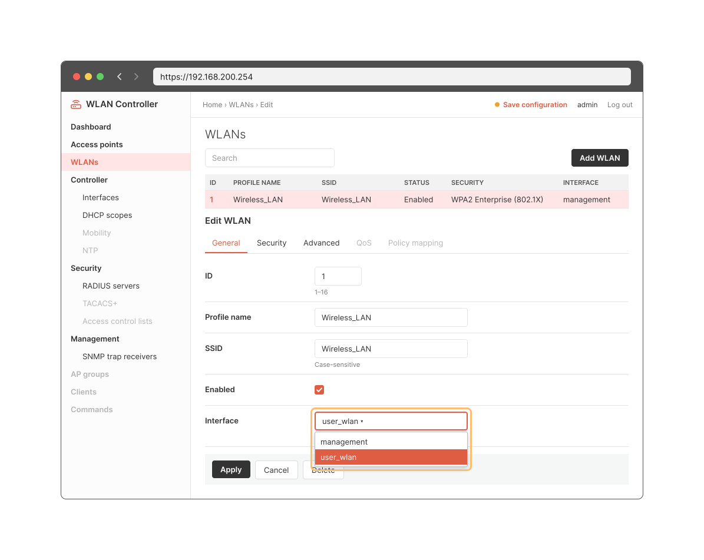

**4. Настройка безопасности WLAN**

Перейдите на вкладку **Security** (безопасность), чтобы получить доступ ко всем доступным параметрам защиты локальной сети. Администратор хочет защитить уровень 2 с помощью WPA2-PSK. По умолчанию выбран **WPA2 Enterprise (802.1X)**. В списке **Layer 2 security** (безопасность уровня 2) выберите **WPA2 Personal (PSK)** и введите ключ в поле **Pre-shared key**; шифрование — **AES**. Затем нажмите **Apply** (применить). Это активирует WLAN с аутентификацией WPA2-PSK. Беспроводные клиенты, которые знают предварительный общий ключ, теперь могут связываться и аутентифицироваться с AP.

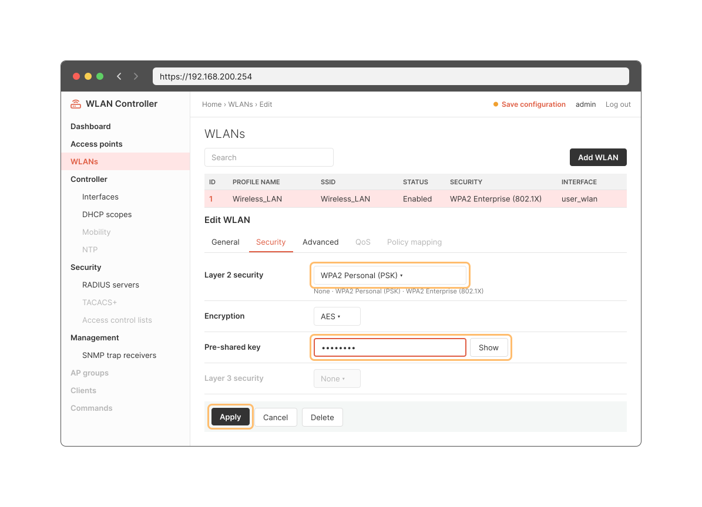

**5. Проверка того, что WLAN работает**

Нажмите **WLANs** в меню слева, чтобы просмотреть вновь настроенную WLAN. В списке можно убедиться, что WLAN с ID 1 использует **Wireless\_LAN** в качестве имени профиля и SSID, включена (**Enabled**), использует защиту WPA2 Personal (PSK) и интерфейс **user\_wlan**.

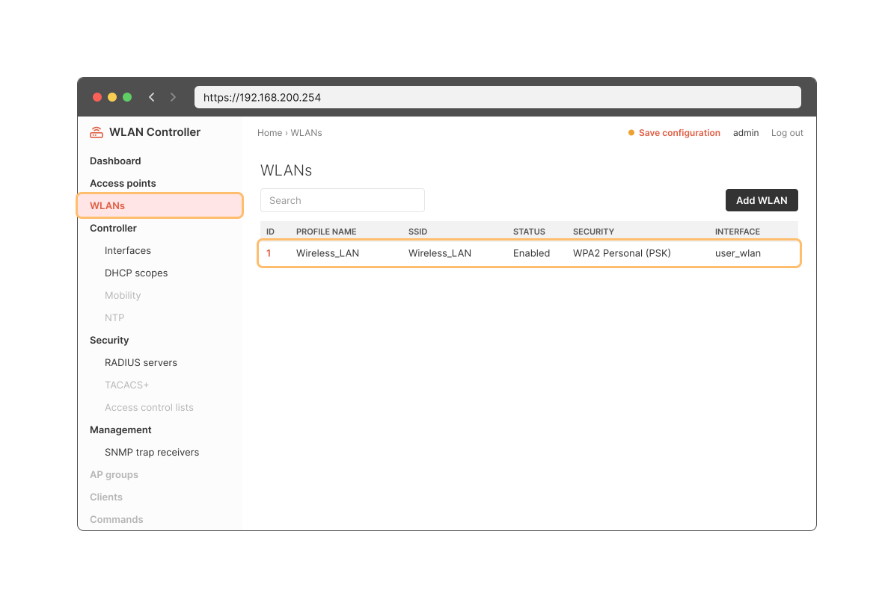

**6. Мониторинг WLAN**

Нажмите **Dashboard** в меню слева. Здесь вы можете видеть, что у **Wireless\_LAN** теперь есть один клиент, использующий ее сервисы: панель показывает одну точку доступа, одного клиента и одну включенную WLAN.

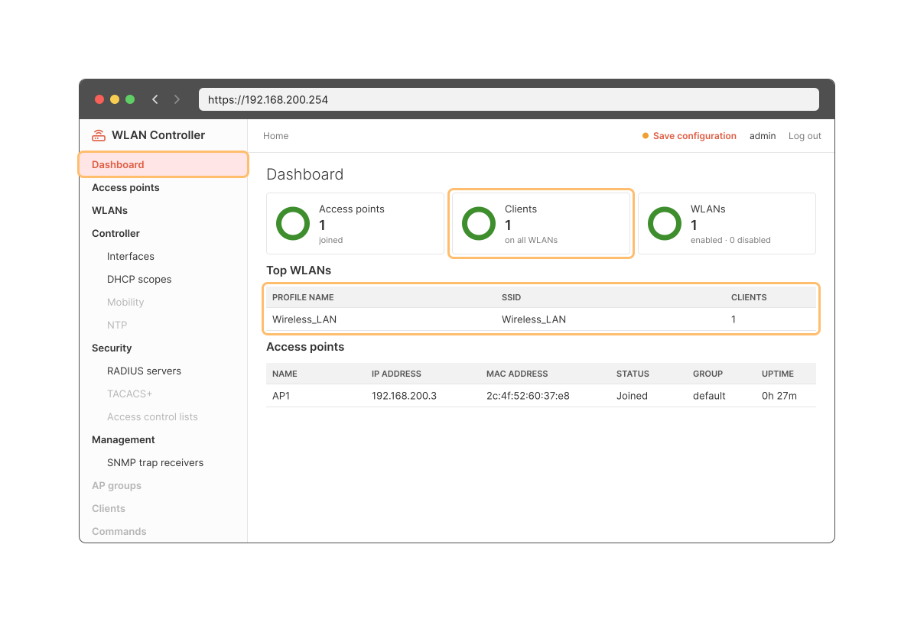

**7. Просмотр сведений о беспроводном клиенте**

Нажмите **Clients** (клиенты) в левом меню, чтобы просмотреть дополнительную информацию о клиентах, подключенных к WLAN. Один клиент с MAC-адресом 00:13:ce:57:7c:67 подключен к **Wireless\_LAN** через AP1 и получил IP-адрес 192.168.5.2. Службы DHCP в этой топологии предоставляются маршрутизатором.

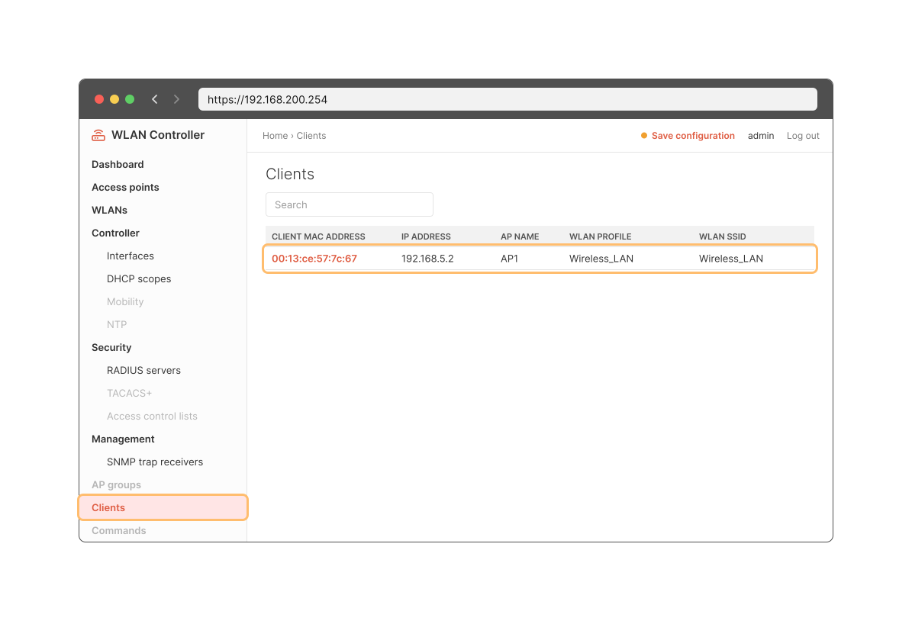
