<!-- 13.3.1 -->
## Серверы SNMP и RADIUS на WLC

Предыдущая тема охватывала базовую конфигурацию WLAN на WLC. Теперь вы узнаете о настройке WPA2 Enterprise WLAN.

На PC-A (172.16.1.254) работают серверы SNMP и RADIUS. WLC и PC-B находятся в сети управления 192.168.200.0/24.

1. В браузере на PC-B открывается адрес управления WLC — https://192.168.200.254; вход под именем admin.
2. В разделе **Management** пункт **SNMP trap receivers** показывает, что получателей прерываний пока нет. Кнопка **Add trap receiver** открывает форму: имя сообщества **WLAN\_SNMP** и IP-адрес сервера SNMP — 172.16.1.254. После **Apply** получатель появляется в списке со статусом **Enabled**: WLC пересылает сообщения журнала на сервер SNMP.
3. В разделе **Security** пункт **RADIUS servers** показывает, что серверов RADIUS пока нет. Кнопка **Add server** открывает форму: индекс 1, IPv4-адрес PC-A 172.16.1.254, порт 1812 по умолчанию. Общий ключ вводится дважды, в полях **Shared secret** и **Confirm shared secret**: это пароль между WLC и сервером RADIUS, а не для пользователей.
4. После **Apply** сервер появляется в списке серверов аутентификации RADIUS: 1, 172.16.1.254, 1812, **Enabled**.
5. Пока изменения не сохранены, у ссылки **Save configuration** горит метка «●». **Save configuration** сохраняет конфигурацию контроллера, и метка гаснет.


<!-- 13.3.2 -->
## SNMP и RADIUS

Например, PC-A, подключенный к интерфейсу F0/0 маршрутизатора R1 и имеющий адрес 172.16.1.254, работает с программным обеспечением серверов службы удалённой аутентификации пользователей по коммутируемым линиям (RADIUS) и простого протокола сетевого управления (SNMP). SNMP используется для мониторинга сети. Администратор хочет, чтобы WLC пересылал все сообщения журнала SNMP, называемые прерываниями, на сервер SNMP.

Кроме того, для аутентификации пользователя WLAN администратор сети хочет использовать сервер RADIUS для служб аутентификации, авторизации и учета (AAA). Вместо того, чтобы вводить общедоступный предварительный общий ключ для аутентификации, как это происходит с WPA2-PSK, пользователи вводят свои собственные имя пользователя и пароль. Учетные данные будут проверены сервером RADIUS. Таким образом, индивидуальный доступ пользователей может отслеживаться и проверяться при необходимости, а их учетные записи могут быть добавлены или изменены из центрального местоположения. Сервер RADIUS требуется для беспроводных локальных сетей, которые используют аутентификацию WPA2 Enterprise.

**Примечание.** Настройка SNMP-сервера и RADIUS-сервера выходит за рамки этого модуля.


<!-- 13.3.3 -->
## Настройка информацию о сервере SNMP

В меню слева в разделе **Management** нажмите **SNMP trap receivers**, затем **Add trap receiver**.

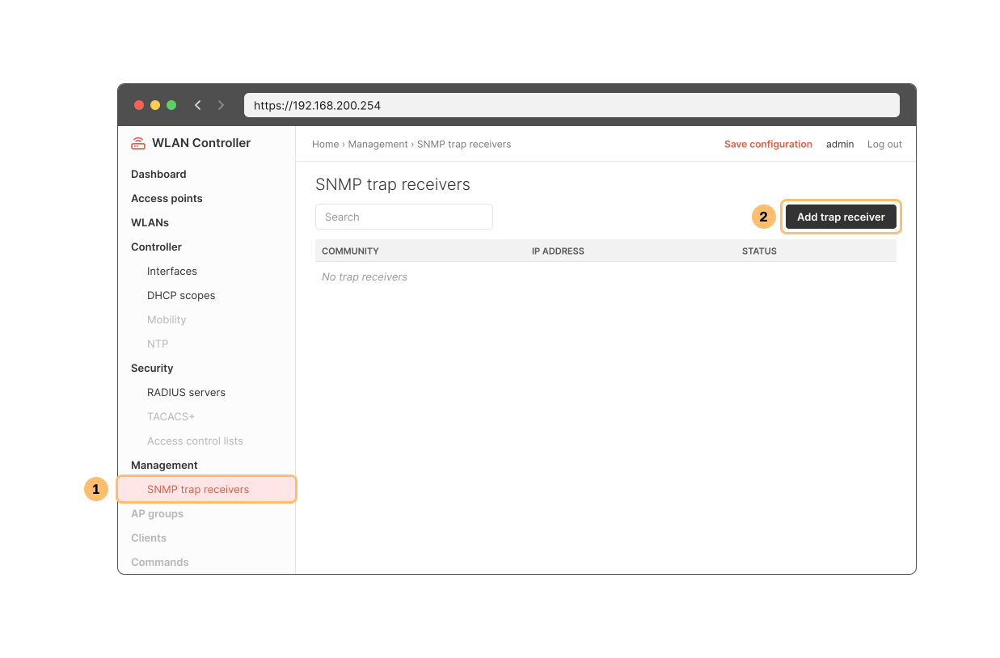

1. Нажмите **SNMP trap receivers**.
2. Нажмите **Add trap receiver**.

Введите **Community name** и IP-адрес (IPv4 или IPv6) для сервера SNMP. Нажмите кнопку **Apply**. Теперь WLC будет пересылать сообщения журнала SNMP на сервер SNMP.

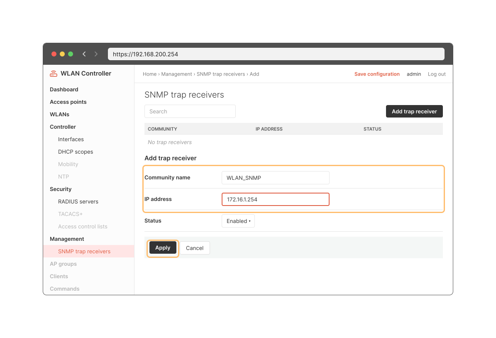

<!-- 13.3.4 -->
## Настройка информации о сервере RADIUS

В нашем примере конфигурации администратор сети хочет настроить WLAN с использованием WPA2 Enterprise, а не WPA2 Personal или WPA2 PSK. Аутентификация будет выполняться сервером RADIUS, работающим на PC-A.

Чтобы настроить WLC с информацией о сервере RADIUS, в меню слева в разделе **Security** нажмите **RADIUS servers**. Серверы RADIUS в настоящее время не настроены. Нажмите **Add server**, чтобы добавить PC-A в качестве сервера RADIUS.

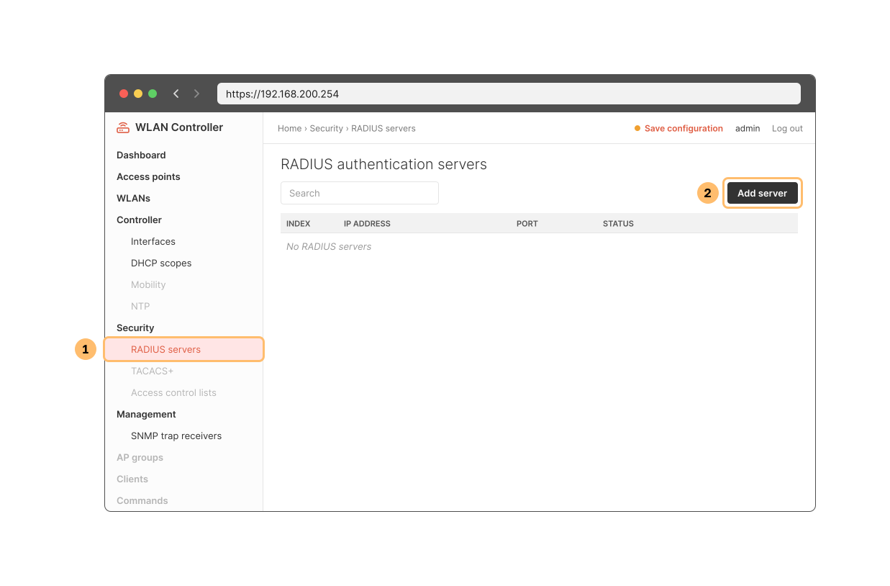

1. Нажмите **RADIUS servers**.
2. Нажмите **Add server**.

Введите адрес IPv4 для PC-A (172.16.1.254) и ключ аутентификации с сервером в полях **Shared secret** и **Confirm shared secret**. Это пароль, используемый между WLC и сервером RADIUS. Это не для пользователей. Порт аутентификации RADIUS по умолчанию — 1812. Нажмите **Apply**.

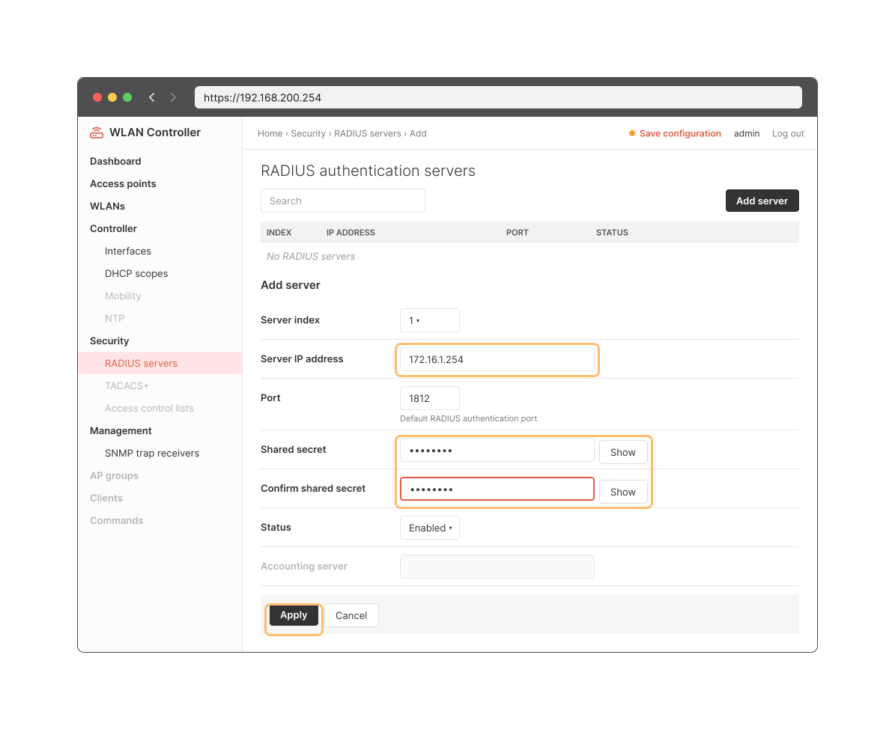

После нажатия кнопки **Apply** список настроенных **серверов аутентификации RADIUS** обновляется, и в списке появляется новый сервер: индекс 1, адрес 172.16.1.254, порт 1812, состояние **Enabled**.

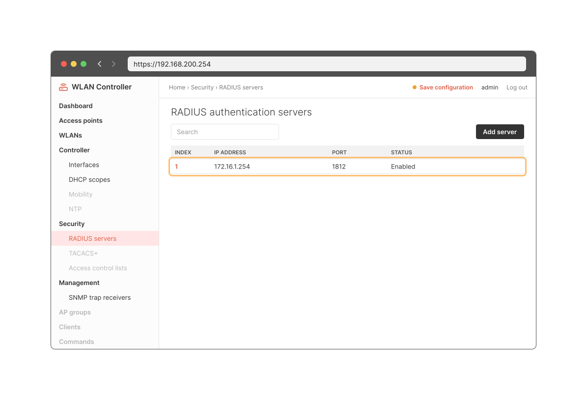

<!-- 13.3.5 -->
## Интерфейс VLAN для новой WLAN

Новая WLAN будет использовать VLAN 5 и сеть 192.168.5.0/24.

1. Щелчок по R1 на холсте открывает его консоль; кнопка в ее заголовке переносит консоль в отдельное окно. Команда **show ip interface brief** показывает, что у R1 уже есть подинтерфейс FastEthernet0/1.5 с адресом 192.168.5.1.
2. В браузере на PC-B открывается адрес управления WLC — https://192.168.200.254; вход под именем admin.
3. В разделе **Controller** пункт **Interfaces** показывает пока один интерфейс — **management**. Кнопка **Add interface** открывает форму: имя интерфейса **vlan5** и VLAN ID **5**. После **Apply** интерфейс vlan5 появляется в списке, адреса у него пока нет.
4. Щелчок по строке vlan5 открывает форму **Edit Interface**: номер порта — 1, IPv4-адрес 192.168.5.254, маска 255.255.255.0, шлюз — R1, 192.168.5.1.
5. В поле **Primary DHCP server** — 192.168.5.1: клиенты новой WLAN получат адреса из пула DHCP на R1. Затем **Apply**.
6. В списке интерфейсов появляется vlan5: VLAN 5, порт 1, 192.168.5.254, тип **Dynamic**. **Save configuration** сохраняет конфигурацию контроллера.


<!-- 13.3.6 -->
## Топология с адресацией VLAN 5

Каждой WLAN, настроенной на WLC, нужен собственный виртуальный интерфейс. WLC имеет пять физических портов для трафика данных. Каждый из них может быть настроен для поддержки нескольких беспроводных локальных сетей с собственным виртуальным интерфейсом. Физические порты также можно объединять для создания каналов с высокой пропускной способностью.

Администратор сети решил, что новая WLAN будет использовать интерфейс VLAN 5 и сеть 192.168.5.0/24. R1 уже имеет настроенный подинтерфейс F0/1.5 для VLAN 5 с адресом 192.168.5.1, это видно в выводе команды **show ip interface brief**. Интерфейс WLC в VLAN 5 получит адрес 192.168.5.254, а адрес управления WLC остается 192.168.200.254.


```
R1# show ip interface brief
Interface                  IP-Address      OK? Method Status                Protocol
FastEthernet0/0            172.16.1.1      YES manual up                    up
FastEthernet0/1            unassigned      YES unset  up                    up
FastEthernet0/1.1          192.168.200.1   YES manual up                    up
FastEthernet0/1.5          192.168.5.1     YES manual up                    up
(output omitted)
R1#
```

<!-- 13.3.7 -->
## Настройте новый интерфейс

Конфигурация интерфейса VLAN на WLC включает следующие шаги:

1. создайте новый интерфейс;
2. настройте имя и идентификатор VLAN;
3. настройте порт и адрес интерфейса;
4. настройте адрес DHCP-сервера;
5. примените и подтвердите;
6. проверьте состояния интерфейса.

**1. Создайте новый интерфейс**

Чтобы добавить новый интерфейс, в меню слева в разделе **Controller** нажмите **Interfaces**, затем **Add interface**.

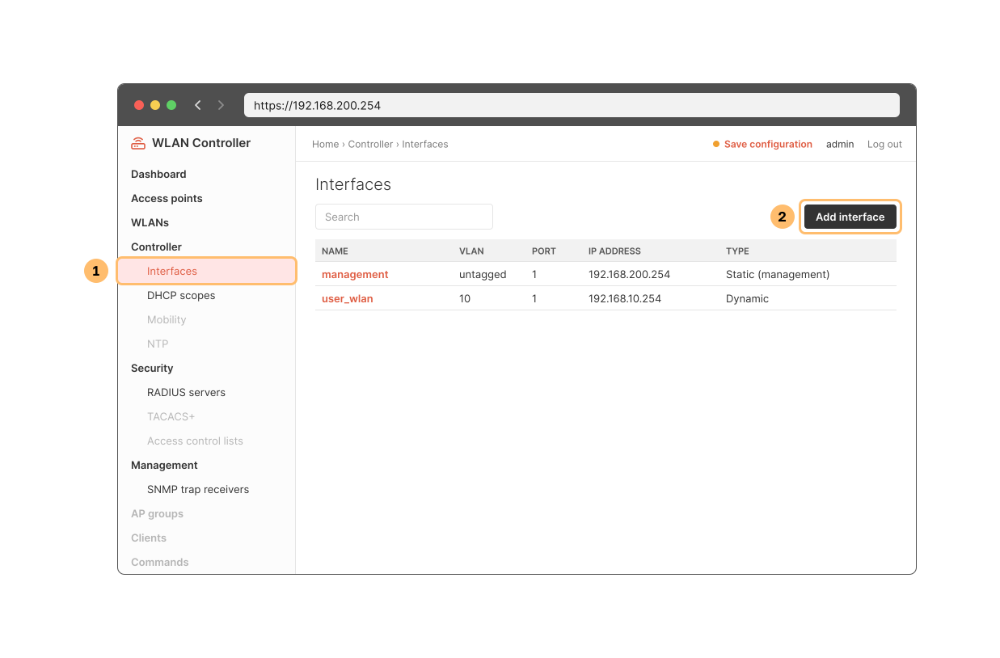

1. Нажмите **Interfaces**.
2. Нажмите **Add interface**.

**2. Настройте имя и идентификатор VLAN**

Администратор сети настраивает имя интерфейса как **vlan5** и VLAN ID как **5**. Нажатие **Apply** создаст новый интерфейс.

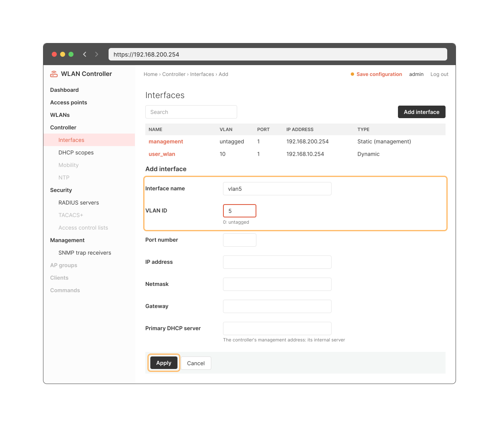

**3. Настройте порт и адрес интерфейса**

Щелкните строку **vlan5**; в форме **Edit Interface** (редактирование интерфейса) настройте номер физического порта. Порт G1 в топологии — это порт 1 на WLC. Затем настройте адресацию интерфейса VLAN 5: IPv4-адрес 192.168.5.254, маска 255.255.255.0 и шлюз 192.168.5.1. R1 – это шлюз по умолчанию на IPv4-адресе 192.168.5.1.

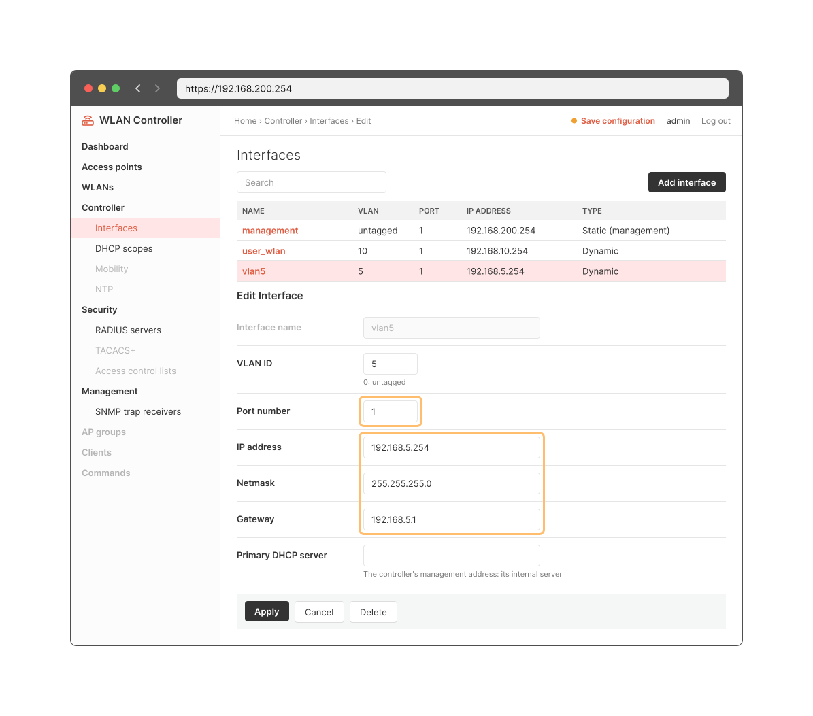

**4. Настройте адрес DHCP-сервера**

На крупных предприятиях WLC будут настроены для пересылки сообщений DHCP на выделенный сервер DHCP. В той же форме в поле **Primary DHCP server** укажите IPv4-адрес 192.168.5.1 — адрес шлюза (маршрутизатора) по умолчанию. Маршрутизатор настроен с пулом DHCP для WLAN. Когда узлы присоединяются к сети, которая связана с интерфейсом VLAN 5, они будут получать информацию адресации из этого пула.

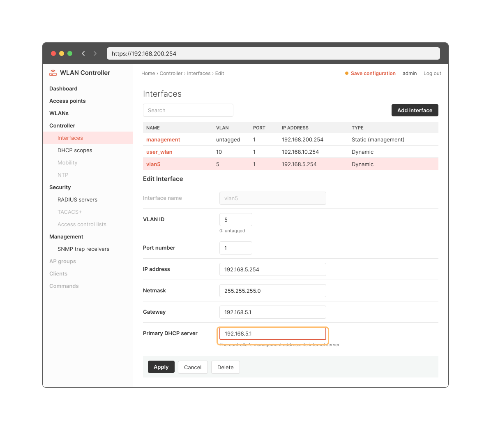

**5. Примените и подтвердите**

Нажмите **Apply**.

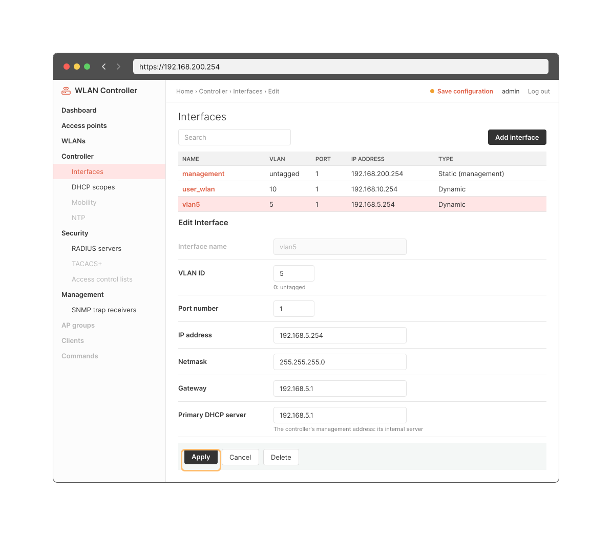

**6. Проверьте состояния интерфейса**

Нажмите **Interfaces**. Новый интерфейс **vlan5** теперь отображается в списке интерфейсов: VLAN 5, порт 1, IPv4-адрес 192.168.5.254, тип **Dynamic**.

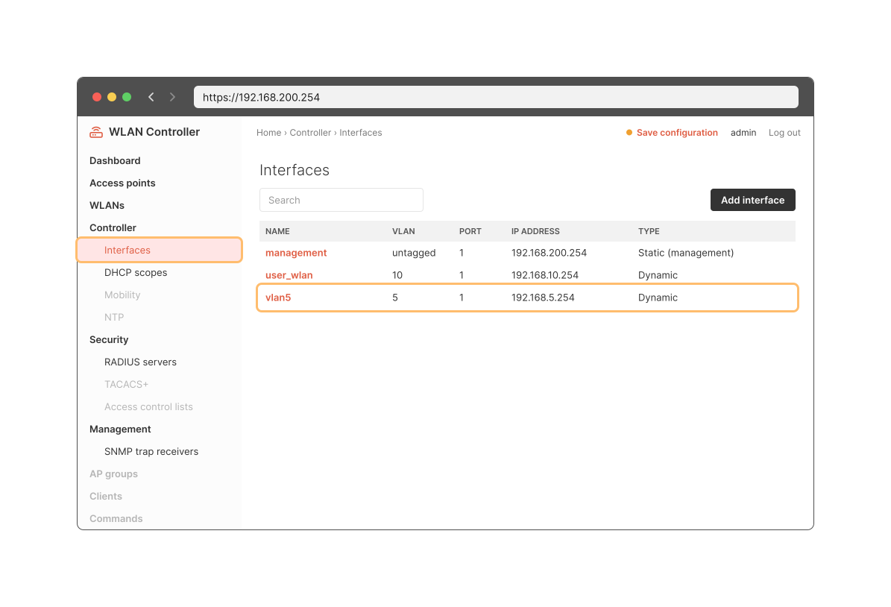

<!-- 13.3.8 -->
## Область DHCP на WLC

WLC, точка доступа AP1 и PC-B находятся в сети управления 192.168.200.0/24; шлюз этой сети — R1, 192.168.200.1.

1. В браузере на PC-B открывается адрес управления WLC — https://192.168.200.254; вход под именем admin.
2. В разделе **Controller** пункт **DHCP scopes** показывает, что областей пока нет. Кнопка **Add DHCP scope** открывает форму: имя области — **Wireless\_Management**. После **Apply** область появляется в списке, пока выключенная (**Disabled**).
3. Щелчок по строке открывает форму **Edit DHCP scope**: пул с 192.168.200.240 по 192.168.200.249 (форма подсчитывает: 10 адресов), сеть 192.168.200.0, маска 255.255.255.0, маршрутизатор по умолчанию — подинтерфейс R1, 192.168.200.1. Остальная часть области не меняется.
4. В списке **Status** выбирается **Enabled**, затем **Apply**.
5. В списке областей — Wireless\_Management: пул 192.168.200.240–192.168.200.249, сеть 192.168.200.0 / 255.255.255.0, **Enabled**. **Save configuration** сохраняет конфигурацию контроллера.


<!-- 13.3.9 -->
## Настройка области DHCP

Настройка области DHCP включает следующие шаги:

1. создайте новую область DHCP;
2. назовите область DHCP;
3. проверьте новую область DHCP;
4. настройте и включите новую область DHCP;
5. проверьте включение области DHCP.

**1. Создайте новую область DHCP**

Область DHCP очень похожа на пул DHCP на маршрутизаторе. Она может содержать различную информацию, включая пул адресов для назначения клиентам DHCP, информацию о DNS-сервере, время аренды и многое другое. Чтобы настроить новую область DHCP, в меню слева в разделе **Controller** нажмите **DHCP scopes**, затем **Add DHCP scope**.

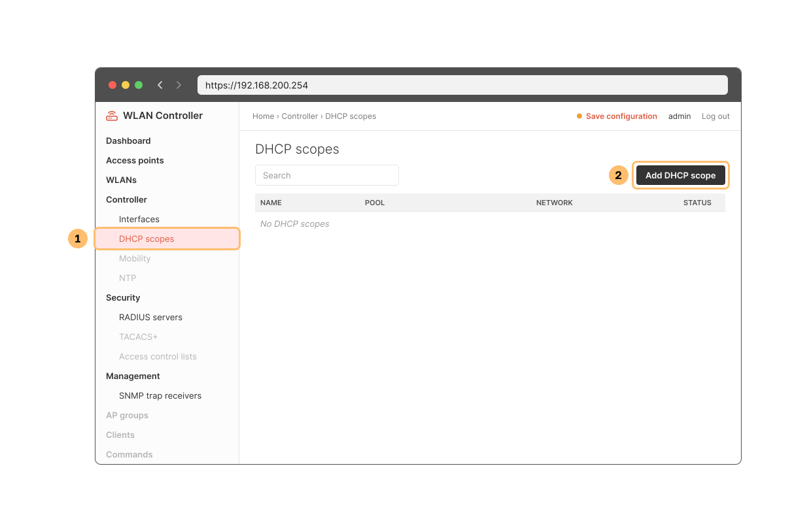

1. Нажмите **DHCP scopes**.
2. Нажмите **Add DHCP scope**.

**2. Назовите область DHCP**

На следующем экране введите имя области. Поскольку она будет применяться к беспроводной сети управления, сетевой администратор использует **Wireless\_Management** в качестве имени и нажимает кнопку **Apply**.

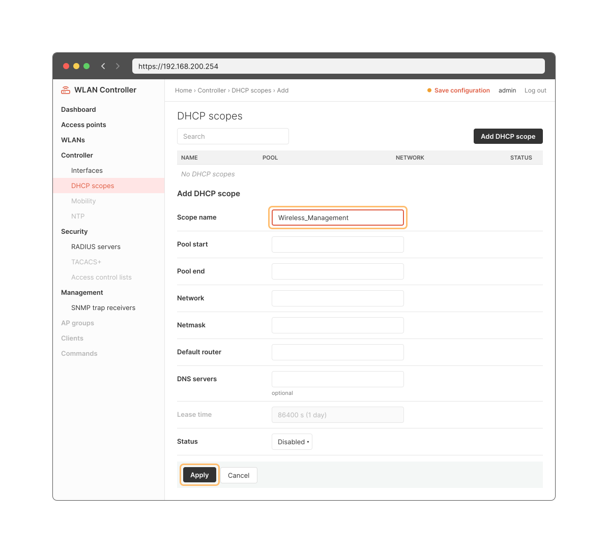

**3. Проверьте новую область DHCP**

Вы вернетесь к списку **DHCP scopes** и сможете убедиться, что область готова к настройке. Нажмите ее новое имя, чтобы настроить область DHCP.

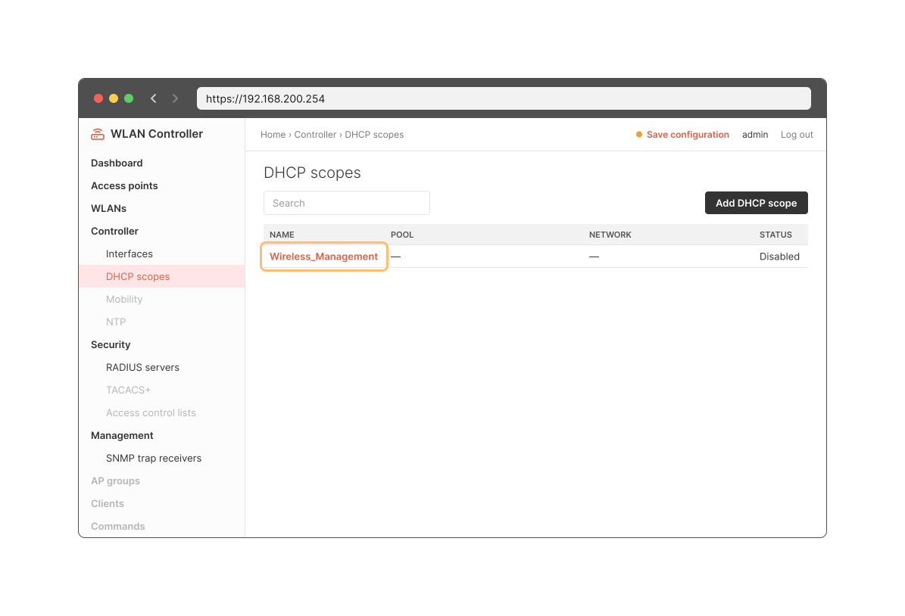

**4. Настройте и включите новую область DHCP**

В форме **Edit DHCP scope** под списком областей для **Wireless\_Management** настройте пул адресов для сети 192.168.200.0/24, начиная с .240 и заканчивая .249. Сетевой адрес и маска подсети настроены. IPv4-адрес маршрутизатора по умолчанию — подинтерфейс R1, 192.168.200.1. Для этого примера остальная часть области остается неизменной. Администратор сети выбирает **Enabled** в раскрывающемся списке **Status** и нажимает **Apply**.

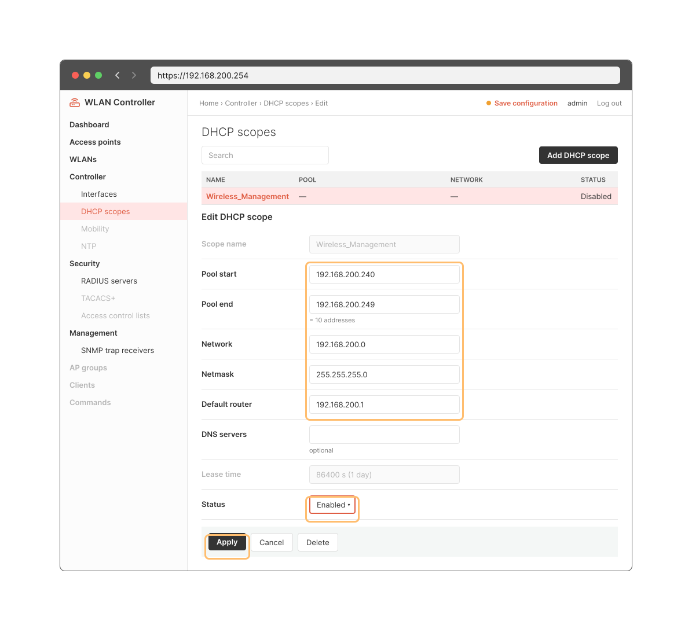

**5. Проверьте включение области DHCP**

Сетевой администратор возвращается на страницу **DHCP Scopes** и может убедиться, что область готова для выделения новой WLAN.

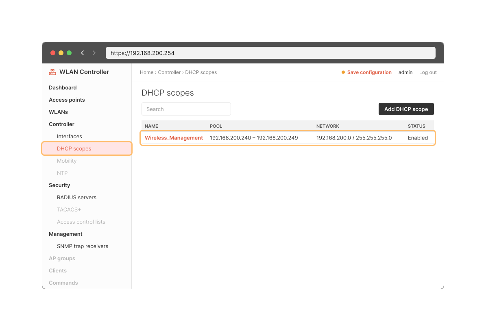

<!-- 13.3.10 -->
## WLAN с WPA2 Enterprise

На WLC уже настроены сервер RADIUS (PC-A, 172.16.1.254), интерфейс vlan5 и WLAN Wireless\_LAN с WPA2 Personal (PSK). Беспроводной адаптер ноутбука сотрудника настроен на сеть CompanyName с его учетной записью.

1. В браузере на PC-B открывается адрес управления WLC — https://192.168.200.254; вход под именем admin.
2. В разделе **WLANs** кнопка **Add WLAN** открывает форму новой WLAN: ID **5** — как у VLAN, имя профиля и SSID **CompanyName**. После **Apply** WLAN появляется в списке, но выключена (**Disabled**).
3. Щелчок по строке открывает форму **Edit WLAN**: флажок **Enabled** включает WLAN, в списке **Interface** выбирается **vlan5**.
4. На вкладке **Security** по умолчанию выбраны **WPA2 Enterprise (802.1X)** и шифрование **AES**.
5. В списке **RADIUS server** выбирается сервер 172.16.1.254. **Apply** нажимается один раз, в конце: включенной WLAN с 802.1X нужен сервер RADIUS.
6. В списке WLANs обе сети включены: Wireless\_LAN с WPA2 Personal (PSK) и CompanyName с WPA2 Enterprise (802.1X). **Save configuration** сохраняет конфигурацию контроллера.
7. На странице **Dashboard** — две включенные WLAN и один клиент: ноутбук подключился к CompanyName, сервер RADIUS принял его учетную запись. В разделе **Clients** у клиента адрес 192.168.5.2 из VLAN 5, точка доступа AP1 и WLAN CompanyName. На холсте между AP1 и ноутбуком — беспроводная связь «CompanyName · 802.1X».


<!-- 13.3.11 -->
## Конфигурация WPA2 Enterprise WLAN

По умолчанию все вновь созданные WLAN на WLC будут использовать WPA2 с Advanced Encryption System (AES). **802.1X** – это протокол управления ключами по умолчанию, используемый для связи с сервером RADIUS. Поскольку сетевой администратор уже настроил WLC с IPv4-адресом сервера RADIUS, работающего на PC-A, единственной конфигурацией остается создать новую WLAN для использования интерфейса **vlan5**.

Конфигурация новой WLAN на WLC включает следующие шаги:

1. создайте новую WLAN;
2. настройте имя WLAN и SSID;
3. включите WLAN для VLAN 5;
4. проверьте AES и 802.1X по умолчанию;
5. настройте безопасность WLAN для использования сервера RADIUS;
6. убедитесь, что новая WLAN доступна.

**1. Создание новой WLAN.**

Нажмите **WLANs** в меню слева, затем **Add WLAN**, чтобы создать новую WLAN.

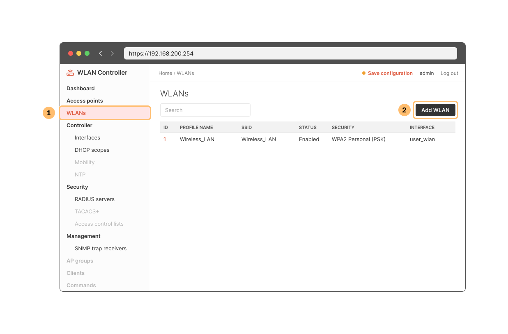

**2. Настройка имя WLAN и SSID**

Введите имя профиля и SSID — **CompanyName**. Чтобы соответствовать VLAN 5, выберите ID **5**. Однако может использоваться любое доступное значение. Нажмите **Apply** для создания новой WLAN.

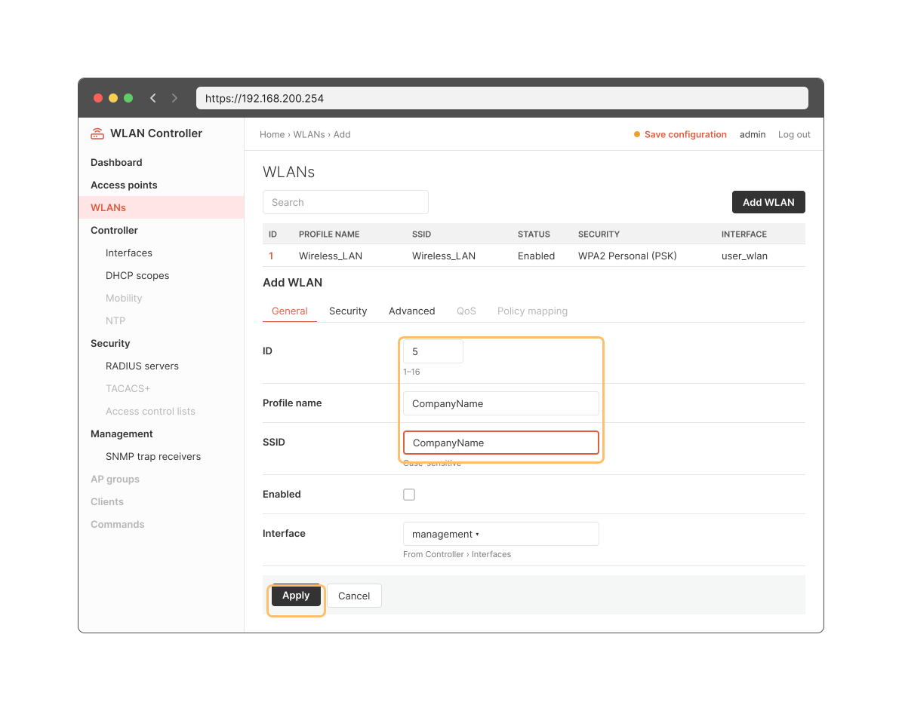

**3. Включите WLAN для VLAN 5**

WLAN создана, но ее все еще необходимо включить и связать с правильным интерфейсом VLAN. Щелкните строку **CompanyName** в списке, отметьте **Enabled** и выберите **vlan5** в списке **Interface**. Применять изменения пока рано: включенной WLAN с WPA2 Enterprise нужен сервер RADIUS, поэтому **Apply** нажимают один раз — после выбора сервера на шаге 5.

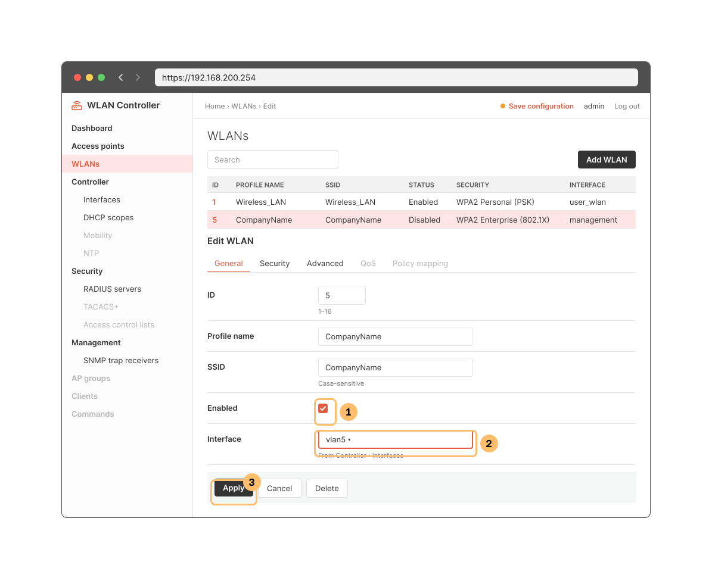


1. Нажмите **Enabled**.
2. Выберите **vlan5** в списке **Interface**.
3. Кнопка **Apply** — она нажимается на шаге 5, после выбора сервера RADIUS.

**4. Проверьте AES и 802.1X по умолчанию**

Нажмите вкладку **Security**, чтобы просмотреть конфигурацию безопасности по умолчанию для новой WLAN. Сеть будет использовать безопасность WPA2 с шифрованием AES. Трафик аутентификации обрабатывается 802.1X между WLC и сервером RADIUS.

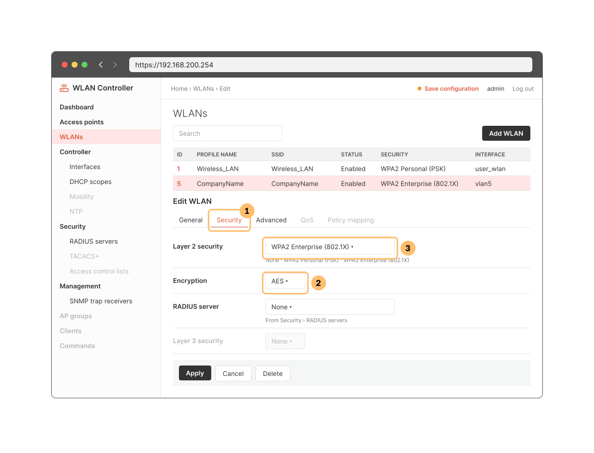


1. Перейдите на вкладку **Security**.
2. Убедитесь, что выбранный механизм шифрования – **AES**.
3. Убедитесь, что в списке **Layer 2 security** выбран **WPA2 Enterprise (802.1X)**.

**5. Настройте RADIUS-сервера**

Теперь нам нужно выбрать сервер RADIUS, который будет использоваться для аутентификации пользователей для этой WLAN. На той же вкладке **Security** в списке **RADIUS server** выберите сервер, который был настроен на WLC ранее. Теперь примените все изменения WLAN — флажок **Enabled**, интерфейс **vlan5** и сервер RADIUS — одним нажатием **Apply**.

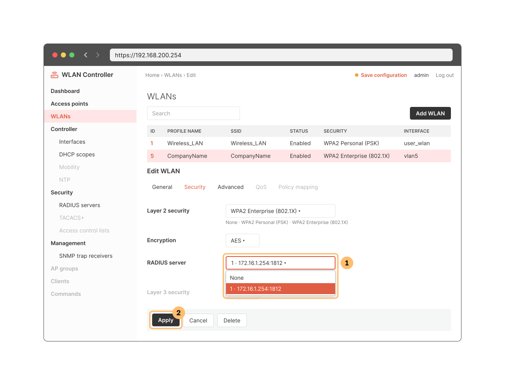


1. В списке **RADIUS server** выберите сервер **172.16.1.254**.
2. Нажмите **Apply**.

**6. Убедитесь, что новая WLAN доступна**

Чтобы убедиться, что новая WLAN включена, нажмите **WLANs** в меню слева. В списке указаны как WLAN **Wireless\_LAN**, так и WLAN **CompanyName**. Обратите внимание, что обе они активированы (**Enabled**): **Wireless\_LAN** использует интерфейс **management**, а **CompanyName** — интерфейс **vlan5**. **Wireless\_LAN** использует WPA2 с аутентификацией PSK. **CompanyName** использует безопасность WPA2 с аутентификацией 802.1X.

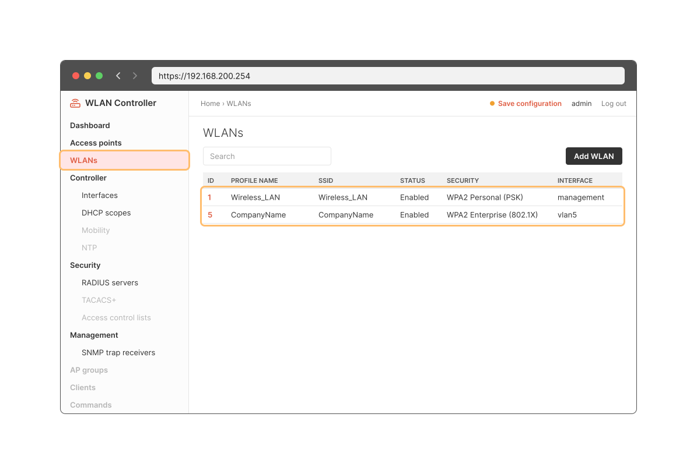
